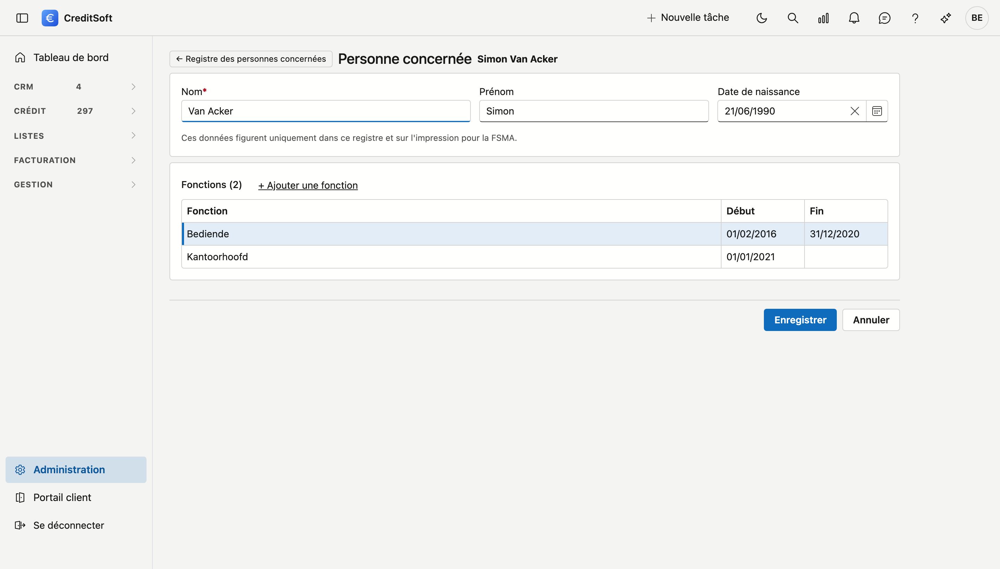

# Registre des personnes concernées

En tant qu'intermédiaire de crédit, vous conservez pour chaque personne concernée le nom, les prénoms, la date de naissance, la fonction exercée et la date à laquelle cette fonction a débuté et, le cas échéant, a pris fin. Vous tenez ces données à la disposition de la FSMA. Ce registre vous permet de les tenir à jour et de les imprimer si nécessaire.

!!! info "Qui doit y figurer ?"
    C'est votre bureau qui décide : toute personne ayant une fonction renseignée figure au registre. En cas de doute sur les personnes concernées, adressez-vous à votre association professionnelle ou à la FSMA. CreditSoft n'en décide pas à votre place.

## Ouvrir l'écran

Dans la barre latérale, cliquez sur **Administration**, puis sur la tuile **Registre des personnes concernées** (sous *Entreprise*). Seules les personnes autorisées à modifier la fiche d'entreprise voient ce registre et peuvent le remplir. Un utilisateur ordinaire ne voit pas la tuile, car le registre contient des dates de naissance.

## La liste

{ .screenshot }

Pour chaque personne, vous voyez la fonction actuelle avec son début et sa fin, ainsi qu'un statut :

| Statut | Signification |
|---|---|
| **Au registre** | Une fonction existe, et le nom, le prénom, la date de naissance et la date de début sont renseignés. |
| **Incomplet** | Une fonction existe, mais il manque encore un nom, un prénom, une date de naissance ou une date de début. |
| **Hors registre** | Aucune fonction n'est renseignée. |

Si le statut est suivi de *fonction en cours, pas de compte actif*, l'accès de cette personne a été retiré alors que sa fonction est toujours en cours. Si elle a arrêté, indiquez la date de fin. CreditSoft ne remplit pas cette date lui-même, car le jour où l'accès d'une personne a pris fin n'est pas toujours le jour où elle a cessé de travailler.

Le filtre vous permet de choisir qui vous voyez : *Au registre* (avec les personnes incomplètes), *Incomplet*, *Hors registre* ou *Tout le monde*. Si personne ne figure encore au registre, vous voyez directement tout le monde.

Double-cliquez sur une ligne pour ouvrir la fiche. La flèche en début de ligne, Ctrl-clic ou le bouton central de la souris ouvrent la fiche dans un nouvel onglet.

## Remplir une personne

Sur la fiche, indiquez le **nom**, le **prénom** et la **date de naissance**, puis cliquez sur **Enregistrer**. Ces données figurent uniquement dans ce registre et sur l'impression. Le nom ne change pas la façon dont la personne s'appelle ailleurs dans CreditSoft.

Si une personne sans compte doit figurer au registre, cliquez dans la liste sur **Nouvelle personne**. Cette personne ne peut pas se connecter et ne figure pas dans les listes de choix des collaborateurs.

## Ajouter une fonction

{ .screenshot }

Cliquez sur **+ Ajouter une fonction**, indiquez la **fonction** et la **date de début**, puis cliquez sur **Enregistrer**. Une fonction est enregistrée immédiatement. Pour une nouvelle personne, enregistrez d'abord la fiche, vous pourrez ensuite ajouter une fonction.

- **Une personne change de fonction :** indiquez la date de fin sur l'ancienne ligne et ajoutez une nouvelle ligne. Les deux fonctions restent ainsi au registre.
- **Une personne arrête :** ouvrez la ligne et indiquez la date de fin. La personne reste au registre.
- **Une ligne a été saisie par erreur :** ouvrez la ligne et cliquez sur **Supprimer**.

## Imprimer le registre

Dans la liste, cliquez sur **Imprimer le registre**. Vous obtenez un aperçu que vous pouvez télécharger, avec en haut votre bureau et votre numéro FSMA repris de la [fiche d'entreprise](company-profile.md). Chaque fonction figure sur sa propre ligne, y compris celles des personnes parties. Les personnes incomplètes y figurent aussi, avec les champs vides visibles.

L'impression est inscrite dans le journal des actions, ce qui vous permet de vérifier qui a imprimé le registre et quand.
