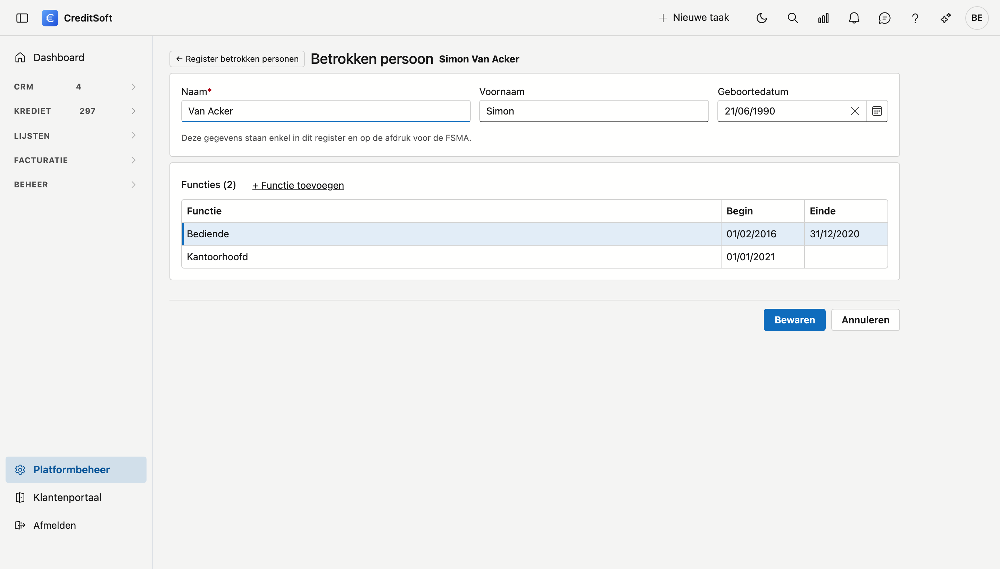

# Register betrokken personen

Als kredietbemiddelaar bewaart u voor elke betrokken persoon de naam, de voornamen, de geboortedatum, de uitgeoefende functie en de datum waarop die functie begon en eventueel eindigde. U houdt die gegevens ter beschikking van de FSMA. In dit register houdt u ze bij, en u drukt ze af wanneer het nodig is.

!!! info "Wie hoort erin?"
    Dat beslist uw kantoor: wie een functie ingevuld heeft, staat in het register. Twijfelt u wie als betrokken persoon telt, vraag het dan aan uw beroepsvereniging of de FSMA. CreditSoft bepaalt dat niet voor u.

## Het scherm openen

Klik in de zijbalk op **Platformbeheer** en daarna op de tegel **Register betrokken personen** (onder *Bedrijf*). Wie de Bedrijfsfiche mag bekijken, ziet ook dit register. Wie de Bedrijfsfiche mag wijzigen, kan het ook invullen.

## De lijst

{ .screenshot }

Per persoon ziet u de huidige functie met haar begin en einde, en een status:

| Status | Wat het betekent |
|---|---|
| **In het register** | Er is een functie, en naam, voornaam, geboortedatum en begindatum zijn ingevuld. |
| **Onvolledig** | Er is een functie, maar er ontbreekt nog een naam, voornaam, geboortedatum of begindatum. |
| **Niet in het register** | Er is geen functie ingevuld. |

Staat er achter de status *functie loopt, geen actief account*, dan is de toegang van die persoon ingetrokken terwijl zijn functie nog loopt. Is hij gestopt, vul dan de einddatum in. CreditSoft vult die datum niet zelf in, want de dag waarop iemands toegang stopte, is niet altijd de dag waarop hij stopte met werken.

Met de filter kiest u wie u ziet: *In het register* (met wie onvolledig is), *Onvolledig*, *Niet in het register* of *Iedereen*. Staat er nog niemand in het register, dan ziet u meteen iedereen.

Dubbelklik een rij om de fiche te openen. Met het pijltje vooraan, Ctrl-klik of de middelste muisknop opent de fiche in een nieuw tabblad.

## Een persoon invullen

Op de fiche vult u de **naam**, de **voornaam** en de **geboortedatum** in, en u klikt op **Bewaren**. Deze gegevens staan enkel in dit register en op de afdruk. De naam verandert niet hoe iemand elders in CreditSoft heet.

Hoort iemand in het register die geen account heeft, klik dan in de lijst op **Nieuwe persoon**. Die persoon kan zich niet aanmelden en staat niet in de keuzelijsten met medewerkers.

## Een functie toevoegen

{ .screenshot }

Klik op **+ Functie toevoegen**, vul de **functie** en de **begindatum** in, en klik op **Bewaren**. Een functie wordt meteen bewaard. Bij een nieuwe persoon bewaart u eerst de fiche, daarna kunt u een functie toevoegen.

- **Iemand verandert van functie:** vul de einddatum in op de oude regel en voeg een nieuwe regel toe. Zo blijven beide functies in het register staan.
- **Iemand stopt:** open de regel en vul de einddatum in. De persoon blijft in het register staan.
- **Een regel is verkeerd ingevoerd:** open de regel en klik op **Verwijderen**.

## Het register afdrukken

Klik in de lijst op **Register afdrukken**. U krijgt een voorbeeld dat u kunt downloaden, met bovenaan uw kantoor en uw FSMA-nummer uit de [Bedrijfsfiche](company-profile.md). Elke functie staat op een eigen regel, ook die van wie vertrokken is. Wie onvolledig is, staat er ook op, met de lege velden zichtbaar.

De afdruk komt in het actielogboek, zodat u kunt nagaan wie het register wanneer afdrukte.
