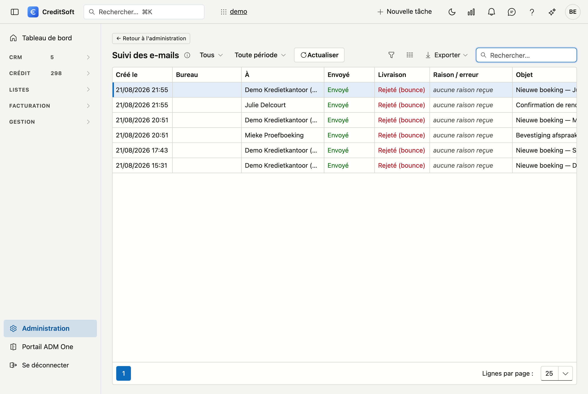

# Suivi des e-mails

L'écran **Suivi des e-mails** vous montre en un seul aperçu **le courrier envoyé par votre bureau** avec son **statut de livraison**. Un administrateur sait ainsi immédiatement ce qui a été livré et ce qui n'est pas arrivé, sans devoir consulter chaque établissement de crédit, assureur ou relation individuellement.

## Ouvrir l'écran

Dans la barre latérale, cliquez sur **Administration**, puis sur la tuile **Suivi des e-mails** (sous *Communication*). En haut, le lien **← Retour à l'administration** vous ramène à l'aperçu.

## Ce que vous voyez

Chaque ligne correspond à un e-mail envoyé. Les colonnes :

- **Créé le** — quand l'e-mail est parti.
- **À** — le destinataire.
- **Envoyé** — si l'e-mail a été envoyé par la plateforme.
- **Livraison** — le **statut de livraison** : **Livré** (vert) si l'e-mail est arrivé, ou un problème en rouge (p. ex. **Rejeté (bounce)** ou **Échoué**).
- **Raison / erreur** — en cas de problème : la raison pour laquelle l'e-mail n'est pas arrivé. Si la plateforme d'envoi n'a transmis aucune raison, la cellule indique *aucune raison reçue*.
- **Objet** — l'objet de l'e-mail.
- **Type** et **Nom** — le type d'entité à laquelle l'e-mail se rapporte (p. ex. *Établissement de crédit*, *Relation*, *Dossier de crédit*) et son nom. Ces deux colonnes n'apparaissent que si au moins un e-mail de la liste les renseigne. Si l'e-mail concerne un dossier de crédit, le nom est un lien : il ouvre **Dossiers de crédit** avec ce nom ou ce numéro de dossier dans le champ de recherche.

## Filtrer et rechercher

- **Filtre de statut** (en haut à gauche) — affichez par exemple uniquement **Non livrés**, **Rejetés (bounce)** ou **Échoués** pour repérer rapidement les cas problématiques. Par défaut, il est sur **Tous**.
- **Période** — affichez uniquement les e-mails des **7, 30 ou 90 derniers jours**. Sur **Toute période**, vous voyez, comme avant, les 500 plus récents.
- **Actualiser** — récupère à nouveau le statut le plus récent.
- **Rechercher** (en haut à droite) — recherchez librement dans la liste, par exemple par destinataire ou objet.
- Le bouton **…** en haut à droite permet d'**exporter** la liste (Excel ou CSV).

## Bon à savoir

- Vous ne voyez que le courrier de **votre propre bureau**. Le courrier parti avant fin août 2026 n'y figure pas : il ne portait pas encore de référence du bureau.
- La liste affiche au maximum les **500 e-mails les plus récents**. S'il y en a davantage, une ligne en haut le signale ; choisissez alors un statut pour affiner.
- Le statut de livraison provient directement de la plateforme d'envoi : **Livré**, **Rejeté (bounce)**, **Échoué**, … C'est la source fiable.
- Les colonnes **Type** et **Nom** se remplissent pour le courrier que vous envoyez **depuis une fiche** (p. ex. depuis un établissement de crédit). Si aucun e-mail de la liste ne porte ces données, les deux colonnes n'apparaissent pas.
