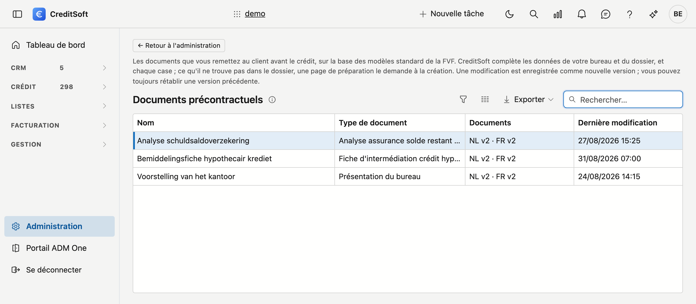
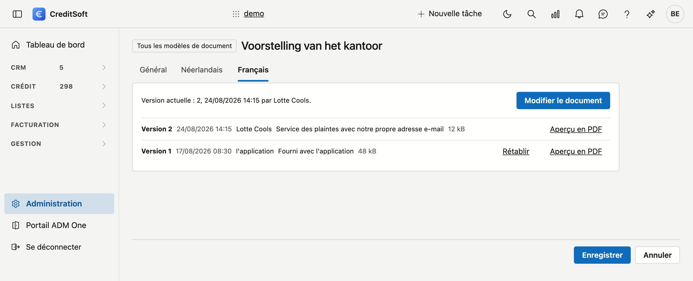
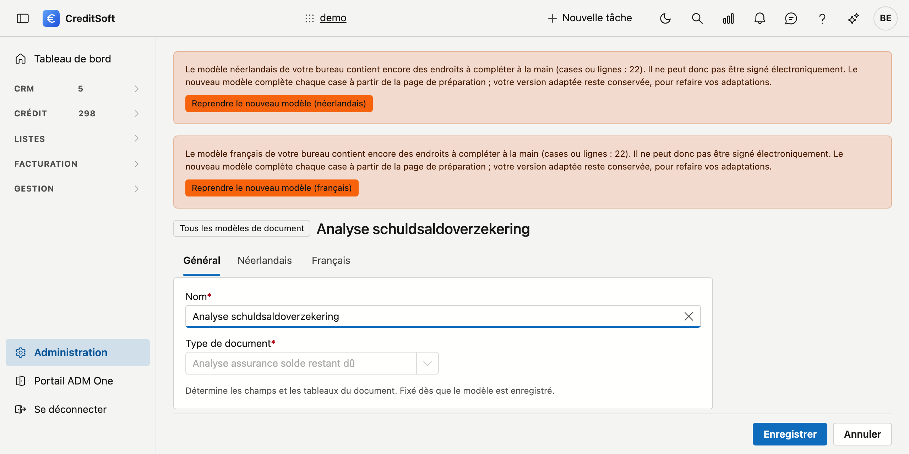
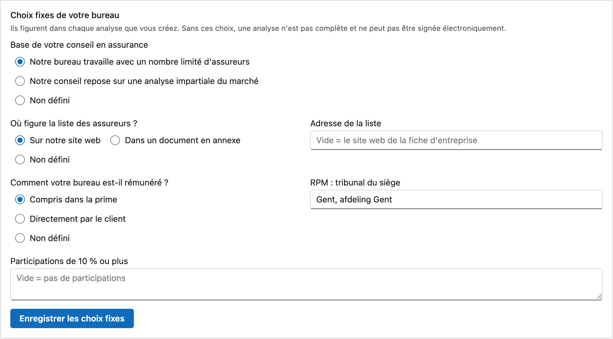
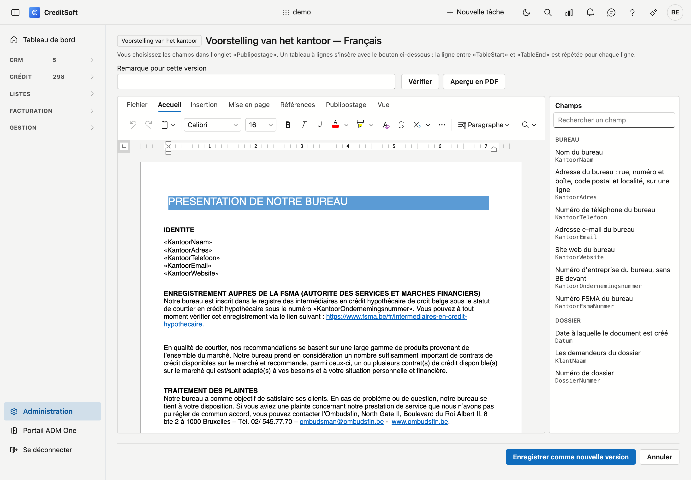
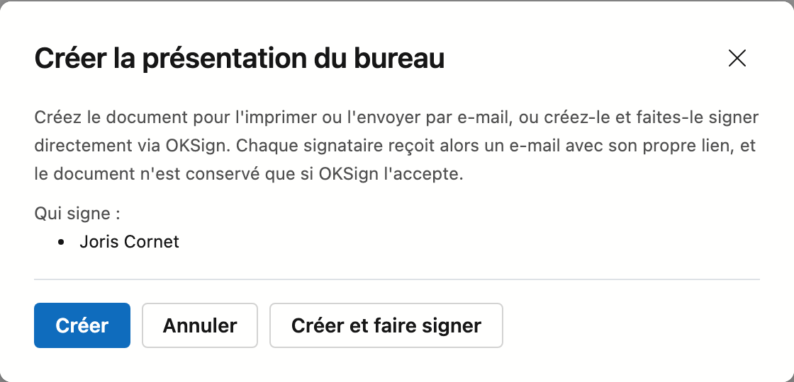

# Documents précontractuels

Avant d'intervenir dans un crédit, vous remettez au client plusieurs documents. CreditSoft en crée trois pour vous, chaque fois sur la base du modèle standard de la FVF, en néerlandais et en français :

- la **présentation du bureau** : l'identité de votre bureau, votre inscription auprès de la FSMA, le traitement des plaintes, la commission et l'exclusion de la responsabilité extracontractuelle ;
- la **fiche d'intermédiation crédit hypothécaire** : les données des demandeurs, l'analyse de leur situation (Partie I), votre recommandation (Partie II) et les annexes (Partie III) ;
- l'**analyse assurance solde restant dû** : les exigences et besoins du client pour une assurance-vie (Partie I), votre conseil (Partie II) et l'information que le client a reçue (Partie III). Elle n'existe que pour un bureau inscrit comme courtier d'assurance.

CreditSoft complète les données de votre bureau à partir de la [fiche d'entreprise](company-profile.md), et celles du dossier lorsque vous créez le document. Cette page explique comment adapter les documents à votre bureau, et comment les créer pour un dossier.

## Ouvrir l'écran

Cliquez dans la barre latérale sur **Administration**, puis sur la tuile **Documents précontractuels** (sous *Entreprise*). Seules les personnes autorisées à modifier la fiche d'entreprise voient la tuile et peuvent adapter les documents.

## La liste

Pour chaque document, vous voyez le nom, les versions qui existent par langue (par exemple *NL v2 · FR v1*) et la date de la dernière modification. Double-cliquez sur une ligne pour ouvrir le document.

Chaque document n'existe qu'une fois. Vous ne pouvez pas en ajouter un deuxième ni le supprimer : CreditSoft en a besoin pour créer le document d'un dossier.

## Les versions d'un document

Le document a un onglet par langue : **Néerlandais** et **Français**. Chaque onglet montre la version actuelle et la liste de toutes les versions, avec la date, la personne qui l'a enregistrée et la remarque qui l'accompagne.

- La **version 1** porte la remarque *Fourni avec l'application*. C'est le modèle standard de la FVF.
- **Aperçu en PDF** montre une version avec les données de votre bureau et la date du jour. Vous voyez ainsi le document tel que le client le reçoit.
- **Rétablir** refait d'une version précédente la version actuelle. Une nouvelle version au même contenu est créée ; rien n'est effacé. Pour revenir au modèle de la FVF, rétablissez la version 1.

Depuis novembre 2026, CreditSoft complète lui-même chaque case de la fiche d'intermédiation et de l'analyse. Si votre bureau n'avait jamais adapté le modèle, le nouveau modèle est déjà en place, avec la remarque *Mis à jour par CreditSoft*. Si vous l'aviez adapté et qu'il contient encore des cases ou des lignes à compléter à la main, un message apparaît en haut avec le bouton **Reprendre le nouveau modèle**. Votre version adaptée reste conservée : vous la rétablissez ou refaites vos adaptations dans le nouveau modèle.

## Choix fixes de votre bureau { #vaste-keuzes }

Ouvrez dans la liste l'**Analyse assurance solde restant dû**. Sous les versions se trouve le bloc **Choix fixes de votre bureau**. Ces choix sont les mêmes dans chaque dossier, et vous les définissez une fois :

- **la base de votre conseil en assurance** : un nombre limité d'assureurs, ou une analyse impartiale du marché ;
- avec un nombre limité : **où figure la liste des assureurs**, sur votre site web (vide = le site web de la fiche d'entreprise) ou dans un document en annexe ;
- **comment votre bureau est rémunéré** : compris dans la prime, ou directement par le client, avec le montant ou le calcul ;
- **le RPM**, avec le tribunal du siège ;
- les **participations** de 10 % ou plus. Vide = aucune.

Cliquez sur **Enregistrer les choix fixes**. Sans ces choix, une analyse n'est pas complète et ne peut pas être signée électroniquement.

## Adapter un document

Dans l'onglet de la langue, cliquez sur **Modifier le document**. Le document s'ouvre dans un éditeur qui fonctionne comme Word.

Les mots entre « » sont des **champs**, comme «KantoorNaam» ou «A1Naam». CreditSoft les complète au moment où le document est créé. Les champs de chaque document et ce que contient chaque champ figurent sur [Champs des documents précontractuels](precontractual-documents-fields.md). Vous insérez un champ avec le panneau **Champs** à droite du document : recherchez un mot et cliquez sur le champ.

Les données de votre bureau proviennent de la fiche d'entreprise. S'il y manque une donnée dont le document a besoin, une ligne pointillée apparaît. Une donnée qui n'existe pas pour chaque bureau, comme le site web, devient une barre oblique (/). Les cases sont aussi des champs : CreditSoft y met ☒ ou ☐.

!!! warning "Pas de cases ni de lignes pointillées à compléter à la main"
    Si vous placez vous-même une case (☐) ou une ligne pointillée dans votre modèle, personne ne la complète, et le document ne peut pas être signé électroniquement. CreditSoft le signale à la création, avec l'endroit où elle se trouve.

Indiquez en haut, dans **Remarque pour cette version**, ce que vous avez modifié, puis cliquez sur **Enregistrer comme nouvelle version**. À partir de ce moment, CreditSoft utilise cette version pour chaque nouveau document dans cette langue.

!!! info "Responsable du texte"
    Le modèle de la FVF est un texte standard pour les courtiers en crédit. Si vous adaptez le texte, il reste celui de votre bureau : CreditSoft ne vérifie pas s'il est conforme à la loi.

## Ce que CreditSoft complète dans la fiche d'intermédiation { #fiche }

| Partie de la fiche | Ce que CreditSoft complète |
|---|---|
| En-tête | Le nom, l'adresse, l'adresse e-mail, le téléphone, le site web et le numéro d'entreprise de votre bureau |
| Données du/des client(s) | Par demandeur : nom, prénom, sexe, adresse, téléphone, GSM, lieu et date de naissance, adresse e-mail ; et le choix de recevoir les informations par voie électronique (page de préparation) |
| 1. Situation personnelle | Le nombre d'enfants à charge, l'état civil, et fumeur (page de préparation) |
| 2.1 Revenus mensuels | La situation professionnelle et les avantages de toute nature (page de préparation) ; la date de début du statut, l'employeur, les revenus mensuels nets, les allocations familiales, les revenus locatifs actuels et les autres revenus ; pour un indépendant le numéro d'entreprise, la date de début et la nature de l'activité |
| 2.2 Charges mensuelles | Le loyer actuel, la pension alimentaire, et une ligne par crédit en cours des deux demandeurs ; sous le tableau, la réponse à la question sur les problèmes financiers dans le passé (page de préparation) |
| 3. Objectif | Le but du crédit (page de préparation) |
| 4 et 5 | Les préférences et les besoins de l'onglet *Conseil*, et la durée souhaitée en mois (page de préparation) |
| Partie II | La case *Nous vous recommandons …*, avec les offres recommandées et leur prêteur, ou la case *Nous ne pouvons pas vous recommander un produit de crédit* |
| Signature | La commune de votre bureau et la date |

- **Les montants** sont mensuels. Un revenu encodé par an compte pour un douzième. Un montant qui n'existe pas, comme l'absence de revenus locatifs, devient une barre oblique (/).
- **Un crédit** est *à rembourser* (Oui) s'il est repris par le nouveau crédit. L'échéance finale provient de la date de fin du crédit. S'il n'y a aucun crédit dans le dossier, vous confirmez sur la page de préparation qu'il n'y en a pas ; sinon, des lignes vides restent.
- **Partie II** : la première case est cochée dès que le conseil compte au moins une offre recommandée. La deuxième est cochée pour un conseil sans offre recommandée. Sans conseil, les deux restent vides.
- **La fiche a deux colonnes.** La première colonne est le premier demandeur du dossier, la deuxième le deuxième. Avec un seul demandeur, la deuxième colonne reste vide. Avec trois ou quatre demandeurs, CreditSoft crée une deuxième fiche pour les demandeurs 3 et 4. Si un demandeur est une entreprise, CreditSoft ne complète que son identité.

## Ce que CreditSoft complète dans l'analyse assurance solde restant dû { #ssv }

L'analyse n'existe que pour un bureau inscrit auprès de la FSMA comme **courtier d'assurance** ; le document le dit aussi. Vous l'activez avec la case sur la [fiche d'entreprise](company-profile.md#verzekeringsmakelaar). Sans cette case, CreditSoft ne crée pas l'analyse.

Le modèle de la FVF est une feuille Excel. CreditSoft en fait un document Word, avec le texte de la FVF tel quel, sans les instructions de la FVF destinées à la personne qui rédige le document. Vous affinez la mise en page dans l'éditeur, comme pour les autres documents.

| Partie de l'analyse | Ce que CreditSoft complète |
|---|---|
| Présentation de notre bureau | Le nom, l'adresse, l'adresse e-mail, le téléphone, le site web, le numéro d'entreprise, le RPM et l'IBAN de votre bureau, et les participations ([choix fixes](#vaste-keuzes)) |
| Vos données | Du premier demandeur : nom, prénom, adresse, date de naissance, numéro de registre national et numéro d'entreprise, et la raison du contact (page de préparation) |
| Partie I | Particulier ou personne morale, les assurés, les garanties, *dans le cadre d'un crédit : Oui*, la totalité ou une partie du capital, l'avantage fiscal, la prime, la durée et les exigences spécifiques |
| Partie II | Conseil ou pas de conseil, le produit, la motivation et si le client suit le conseil ; avec quels assureurs votre bureau travaille ([choix fixes](#vaste-keuzes)) |
| Partie III | L'information complémentaire, la fiche client et la rémunération |
| Signature | La commune de votre bureau et la date |

- **Les assurés** sont les demandeurs assurés sur un contrat d'assurance solde restant dû du dossier (onglet *Contrats*), ou qui figurent sur une ligne de *Cautions, ASRD & réductions*. Le modèle prévoit de la place pour deux.
- **Le numéro de registre national** provient de la fiche de la relation. S'il n'y figure pas, la page de préparation le signale.
- **Le décès** et *dans le cadre d'un crédit : Oui* sont toujours cochés. Les autres cases suivent la page de préparation.

## Créer le document pour un dossier { #maken }

Ouvrez le dossier et cliquez sur l'onglet **Conseil**. Sous le résumé du conseil se trouve le bloc **Documents précontractuels**.

{ .volle-breedte }

- **Créer la présentation du bureau** crée le document directement ; il n'a pas de questions. Si votre bureau a un contrat OKSign, une petite fenêtre s'ouvre d'abord (voir [Créer et faire signer](#ondertekenen)).
- **Créer la fiche d'intermédiation** et **Créer l'analyse assurance solde restant dû** ouvrent la [page de préparation](#invulpagina) de ce document.

CreditSoft crée le document dans la langue du **premier demandeur** du dossier, avec la version actuelle de votre modèle. Le document apparaît dans la liste avec la date et la personne qui l'a créé. Cliquez sur **Ouvrir** pour le consulter. Il est conservé dans les pièces jointes du dossier, dans la catégorie *Precontractueel*.

Un document créé ne change plus. Si vous modifiez ensuite quelque chose, créez le document à nouveau. Un deuxième document s'ajoute ; le premier reste, de sorte que vous pouvez toujours montrer ce que le client a reçu.

Vous avez besoin du droit de modifier le dossier. Le bloc ne figure pas dans le portail des apporteurs.

### La page de préparation { #invulpagina }

Ce que CreditSoft ne trouve pas dans le dossier, la page de préparation du document le demande. Ce que vous y enregistrez reste dans le dossier : si vous recréez le document, il est toujours là.

{ .volle-breedte }

**La fiche d'intermédiation** demande :

- le **but du crédit**, avec le but du dossier à côté comme aide. Si votre bureau a attribué un *objet pour l'estimation* au but du crédit (dans les listes de choix), le but est proposé là où c'est univoque : *construction*, *refinancement*, *rénovation* pour un crédit sans achat, et pour un achat *achat et rénovation* si la fiche d'investissement contient des montants de rénovation. Sans montants de rénovation, vous choisissez vous-même entre *achat* et *achat et rénovation*. Pour *autre*, le nom du but du crédit figure comme texte ;
- si les demandeurs n'ont **pas de crédits en cours**, s'il n'y en a aucun dans le dossier ;
- la **durée souhaitée** en mois. Si les contrats hypothécaires du dossier ont tous la même durée, elle est proposée ; elle ne compte qu'une fois enregistrée. S'ils ont une durée différente, celles-ci figurent à côté comme aide ;
- si les demandeurs ont eu des **problèmes financiers** dans le passé. En cas de *oui*, vous indiquez brièvement quand, auprès de quel organisme et pourquoi ; cela figure sur la fiche sous la question ;
- par demandeur : le choix de recevoir les informations **par voie électronique**, **fumeur**, la **situation professionnelle** (avec les types de revenus de ce demandeur à côté) et les **avantages de toute nature**.

**L'analyse assurance solde restant dû** demande :

- le **conseil** : conseil ou pas de conseil, le produit et l'assureur, la motivation, si le client suit le conseil, et si la fiche client a été parcourue ;
- les **besoins** : la raison du contact, les garanties complémentaires, l'avantage fiscal, la totalité ou une partie du capital, la prime, la durée, les exigences spécifiques et l'information complémentaire.

Chaque question a le choix **Pas encore répondu**. Ainsi, une question à laquelle personne n'a répondu ne se lit jamais comme *non*. Ce que le dossier dit sans ambiguïté, la page le propose : le produit et l'assureur, fumeur *oui* d'une ligne d'assurance solde restant dû, l'avantage fiscal, la totalité ou une partie, la prime et la durée du contrat. Une proposition ne compte qu'une fois enregistrée.

Cliquez en haut sur **Enregistrer**. En bas figure **Ce qui manque encore** : chaque donnée dont le document a encore besoin, avec l'endroit où elle se trouve (par exemple *l'adresse e-mail manque sur la fiche de la relation*). En dessous se trouvent les boutons :

- **Créer** : le document sur papier ou à envoyer par e-mail. C'est toujours possible ; ce qui manque reste alors une ligne pointillée.
- **Créer et faire signer** : uniquement si plus rien ne manque et si votre bureau a un contrat OKSign.

Enregistrez d'abord vos modifications : le document est créé à partir de ce qui est enregistré.

### Créer et faire signer { #ondertekenen }

Si votre bureau a un contrat avec OKSign, vous faites [signer électroniquement](../credit-management/ondertekenen.md) un document précontractuel dès sa création. Un document envoyé pour signature doit être complet : dans OKSign, le client peut seulement signer, rien compléter. Sans contrat, rien ne change.

- **La présentation du bureau** : après un clic sur **Créer la présentation du bureau**, une fenêtre s'ouvre avec qui signe et, s'il manque quelque chose sur la fiche d'entreprise, quoi. Cliquez sur **Créer et faire signer**.
- **La fiche d'intermédiation et l'analyse** : sur la page de préparation, avec **Créer et faire signer**.

Qui signe :

- **La présentation du bureau** : tous les demandeurs du dossier.
- **La fiche d'intermédiation** : les demandeurs de cette fiche. Avec plus de deux demandeurs, CreditSoft crée une fiche par deux demandeurs, et chaque fiche part à ses propres demandeurs.
- **L'analyse assurance solde restant dû** : le client du document, c'est-à-dire le premier demandeur.

Vous, le courtier, ne signez pas électroniquement : votre bureau figure comme émetteur sur le document. S'il manque quelque chose chez un client, comme un numéro de GSM, c'est indiqué à côté de son nom.

Sous le titre *Signature(s)* ou *Signatures* du document, CreditSoft place pour chaque client son nom et un cadre. OKSign y place la signature. Votre modèle ne change pas pour autant. Si vous avez retiré ce titre de votre modèle, les noms et les cadres figurent à la fin du document.

Chaque client reçoit un e-mail avec son propre lien. Le document n'est conservé que si OKSign l'accepte. Si OKSign refuse, ou si le service n'est pas joignable, rien n'est créé ni envoyé.

La liste des documents créés affiche alors la colonne **Signature** :

- **En attente de signature**, avec plusieurs clients le nombre de ceux qui ont déjà signé ;
- **Signé le** une date, avec **Version signée** pour ouvrir le document signé ;
- **Retirée le** une date.

Sous la liste figure chaque document encore en attente, avec pour chaque client **Copier le lien** et **Renvoyer l'e-mail**, et **Retirer…** pour toute la demande. Le document signé rejoint les pièces jointes du dossier, dans la catégorie *Ondertekend*. La personne qui l'a envoyé reçoit une [tâche](../journaal/taken.md) dès que tout le monde a signé.

## Erreurs fréquentes

!!! warning "Faire signer un document après coup"
    Ce n'est pas possible : vous le choisissez à la création. Si vous voulez quand même faire signer un document déjà créé, créez-le à nouveau avec **Créer et faire signer**. Le premier document reste.

!!! warning "Une ligne pointillée à la place d'une donnée"
    Une ligne pointillée signifie : le document a besoin de cette donnée et elle manque. S'il s'agit de votre bureau, complétez-la sur la [fiche d'entreprise](company-profile.md) ; s'il s'agit du client, sur la fiche de cette relation ; s'il s'agit d'une question, sur la [page de préparation](#invulpagina). Créez ensuite le document à nouveau. Une barre oblique (/) n'est pas une erreur : cette donnée n'existe pas pour tout le monde.

!!! warning "Créer et faire signer est désactivé"
    Regardez sous **Ce qui manque encore** sur la page de préparation : tant que quelque chose y figure, ou que vous n'avez pas enregistré une modification, le document ne peut pas être envoyé pour signature.

!!! warning "Le document dans la mauvaise langue"
    La langue suit la langue des documents du **premier demandeur**. Si elle est erronée, modifiez-la sur la fiche de cette relation et créez le document à nouveau.

!!! warning "Le bouton Créer l'analyse assurance solde restant dû manque"
    Ce bouton n'apparaît que si votre bureau figure comme courtier d'assurance sur la [fiche d'entreprise](company-profile.md#verzekeringsmakelaar).

## Voir aussi

- [Champs des documents précontractuels](precontractual-documents-fields.md)
- [Fiche d'entreprise](company-profile.md)
- [Dossiers de crédit](../credit-management/credit-files.md)
- [Conseil](../credit-management/advice.md)
- [Signature électronique (OKSign)](../credit-management/ondertekenen.md)
