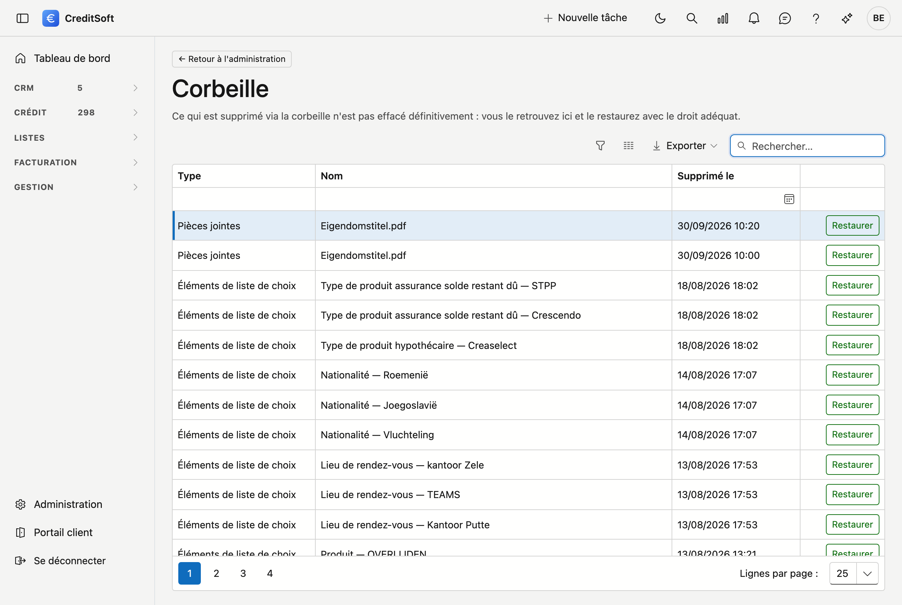

# Corbeille

Dans la **Corbeille**, vous trouvez les enregistrements qui ont été supprimés. Dans CreditSoft, rien n'est effacé définitivement tout de suite : un enregistrement supprimé est déplacé vers la Corbeille et reste **récupérable**. Un administrateur peut ainsi restaurer une relation, un apporteur ou un dossier supprimé par erreur, sans perte de données.

## Ouvrir l'écran

Cliquez dans la barre latérale sur **Administration**, puis sur la tuile **Corbeille** (sous *Données*).

## Ce que vous voyez

Les enregistrements supprimés sont **regroupés par type**, par exemple *Relations*, *Leads*, *Institutions de crédit*, *Assureurs*, *Apporteurs*, *Personnes concernées*, *Dossiers de crédit*, *Rendez-vous* et les éléments du journal (*Tâches*, *Notes*, *Pièces jointes*, *Courrier*). Pour chaque enregistrement, vous voyez :

- **Nom** — le nom ou le titre de l'enregistrement supprimé.
- **Supprimé le** — la date à laquelle il a été placé dans la Corbeille.
- **Restaurer** — le bouton pour remettre l'enregistrement en place.

## Restaurer un enregistrement

Cliquez sur **Restaurer** à côté de l'enregistrement. Celui-ci disparaît de la Corbeille et redevient immédiatement disponible à son emplacement habituel, exactement comme avant.

**Un dossier de crédit.** Si vous supprimez un [dossier de crédit](../credit-management/credit-files.md#supprimer-un-dossier), ses tâches l'accompagnent dans la Corbeille, sous *Tâches*. Si vous restaurez le dossier, ces tâches reviennent avec lui. Une tâche qui avait déjà été supprimée séparément avant le dossier y reste ; vous la restaurez vous-même sous *Tâches*.

**Une personne concernée.** Sous *Personnes concernées* figurent les personnes supprimées dans le [Registre des personnes concernées](involved-persons.md#verwijderen). La restauration remet la fiche dans la liste du registre.

## Bon à savoir

- La Corbeille n'affiche que les enregistrements de **votre bureau** — vous ne voyez jamais les données supprimées d'un autre client.
- La **restauration** nécessite un droit supplémentaire : seules les personnes disposant de ce droit voient le bouton. La consultation et la restauration se règlent par rôle dans **Administration → Rôles**.
- Chaque suppression et chaque restauration est consignée dans l'historique.
