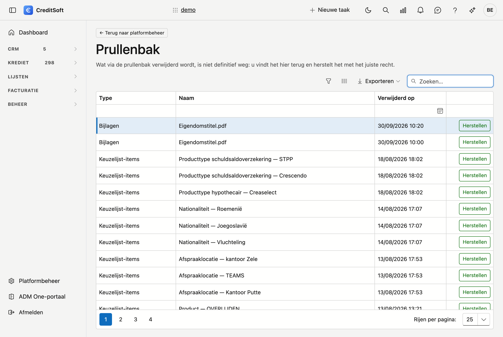

# Prullenbak

In de **Prullenbak** vindt u de records die verwijderd zijn. Bij CreditSoft wordt niets meteen definitief gewist: een verwijderd record verhuist naar de Prullenbak en blijft **herstelbaar**. Zo kan een beheerder een per ongeluk verwijderde relatie, aanbrenger of dossier zonder gegevensverlies terugzetten.

## Het scherm openen

Klik in de zijbalk op **Platformbeheer** en daarna op de tegel **Prullenbak** (onder *Gegevens*).

## Wat u ziet

De verwijderde records staan **gegroepeerd per soort**, bijvoorbeeld *Relaties*, *Leads*, *Kredietinstellingen*, *Verzekeraars*, *Aanbrengers*, *Betrokken personen*, *Kredietdossiers*, *Afspraken* en de journaal-items (*Taken*, *Notities*, *Bijlagen*, *Mailverkeer*). Per record ziet u:

- **Naam** — de naam of titel van het verwijderde record.
- **Verwijderd op** — wanneer het naar de Prullenbak ging.
- **Verwijderd door** — wie het verwijderde, uit het logboek van dat record. Bij bijlagen en mails, en bij wat vóór 22/11/2026 uit het journaal verwijderd werd, is dat niet bekend; dan blijft de cel leeg.
- **Herstellen** — de knop om het record terug te zetten.

## Een record herstellen

Klik naast het record op **Herstellen**. Het record verdwijnt uit de Prullenbak en is meteen weer beschikbaar op zijn gewone plaats, precies zoals voordien.

**Een kredietdossier.** Verwijdert u een [kredietdossier](../credit-management/credit-files.md#een-dossier-verwijderen), dan gaan zijn taken mee naar de Prullenbak, onder *Taken*. Herstelt u het dossier, dan komen die taken mee terug. Een taak die al vóór het dossier apart verwijderd werd, blijft staan; die herstelt u zelf onder *Taken*.

**Een betrokken persoon.** Onder *Betrokken personen* staan de personen die verwijderd werden in het [Register betrokken personen](involved-persons.md#verwijderen). Herstellen zet de fiche terug in de lijst van het register.

## Goed om weten

- De Prullenbak toont enkel de records van **uw kantoor** — u ziet nooit de verwijderde gegevens van een andere klant.
- **Herstellen** vereist een bijkomend recht: alleen wie dat recht heeft, ziet de knop. Bekijken en herstellen kunt u per rol regelen bij **Platformbeheer → Rollen**.
- Elke verwijdering en elk herstel wordt netjes bijgehouden in de historiek.
