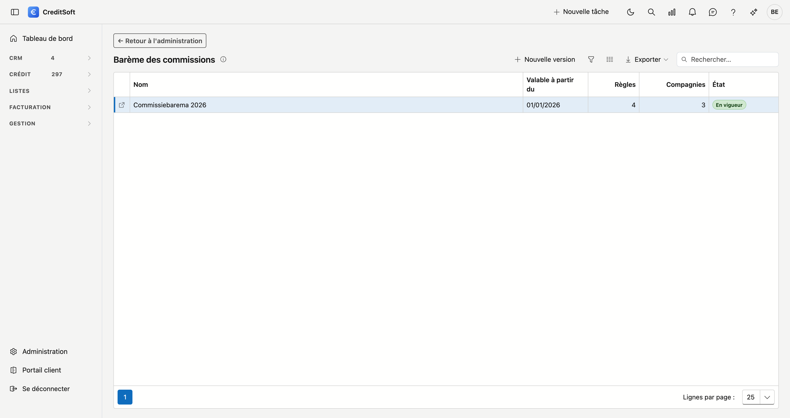

# Barème des commissions

Le barème, c'est ce que les compagnies paient à votre bureau par crédit conclu : le pourcentage, les limites, les conditions et le rythme de paiement. CreditSoft s'en sert pour proposer la commission d'un dossier, la répartir entre le bureau apporteur et le bureau principal, et calculer ce qu'une compagnie récupère quand un crédit se termine plus tôt.

Si votre bureau ne travaille pas avec un barème, laissez cet écran vide. Aucune proposition n'apparaît alors.

## Ouvrir l'écran

Allez dans **Administration** en bas du menu, et cliquez sous *Crédit* sur la tuile **Barème des commissions**. Il vous faut le droit de gérer les paramètres de commission.

{ .volle-breedte }

## Versions

Un barème change quelques fois par an. Chaque changement est une nouvelle **version** avec une date **Valable à partir du**. Une version s'applique aux dossiers dont la **date d'acte** tombe à partir de cette date, jusqu'au début de la version suivante. Si un dossier n'a pas encore d'acte, c'est la date d'introduction qui compte, sinon aujourd'hui.

Un dossier de l'an dernier calcule donc avec le barème de l'an dernier, même après l'introduction d'une nouvelle version. L'étiquette **En vigueur** figure à côté de la version valable aujourd'hui.

### Une nouvelle version

Cliquez sur **Nouvelle version**. Vous indiquez un nom et la date *Valable à partir du*. Sous **Sur la base de**, choisissez une version précédente : toutes ses règles suivent, y compris les paliers de réduction de taux et de récupération, et vous n'adaptez que ce qui a changé. Avec **Commencer vide**, vous introduisez toutes les règles vous-même.

Cliquez sur une version dans la liste pour voir ses règles. Vous y modifiez le nom, la date et les remarques, et **Supprimer** retire une version. Les dossiers dont l'acte tombait dans cette version calculent alors avec la précédente.

{ .volle-breedte }

## Une règle

Une règle correspond à une compagnie, ou à une **formule** d'une compagnie qui en a plusieurs (par exemple *Formule A* et *Formule B*). **+ Ajouter une règle** en crée une ; double-cliquez une règle pour la modifier.

### Compagnie et formule

- **Compagnie** — l'institution de crédit, comme sur le dossier.
- **Formule** — uniquement si la compagnie a plusieurs règles. Laissez vide s'il n'y en a qu'une.
- **Produits** — les produits concernés par cette règle. Un contrat avec un tel produit choisit alors cette règle lui-même. Laissez vide pour que la règle vaille pour tous les produits.

### La commission

Choisissez **Pourcentage du crédit**, **Montant fixe** ou **Pour info**.

- **Pourcentage** — du montant du crédit. *Calculé sur au plus* limite le montant de calcul (par exemple 1.000.000).
- **Montant fixe** — un seul montant par crédit, quel que soit le montant du crédit.
- **Commission minimale** et **maximale** — des limites sur le résultat.
- **Pour info** — la règle ne calcule pas ; elle figure pour qui relit le barème. « Pas de commission » est un pourcentage de 0.

### Conditions

Laissez vide ce qui ne compte pas. Une règle ne s'applique que si **toutes** les conditions remplies sont vérifiées ; s'il manque une donnée sur le dossier (par exemple la durée), la règle ne s'applique pas.

- **Durée** et **taux** — « à partir de » est inclus, « moins de » ne l'est pas. « Plus de 7 ans » = *à partir de 84 mois*, « moins de 7 ans » = *moins de 84*.
- **Date d'introduction** et **date d'acte** — les deux dates sont incluses.

### Paiement par la compagnie

Le rythme auquel la compagnie paie votre bureau. Les schémas de commission du bureau et du bureau principal suivent le même rythme.

- **Selon l'institution de crédit** — le schéma figurant sur la fiche de l'institution de crédit.
- **Une partie directe, le reste étalé** — un pourcentage le mois après l'acte, le reste sur un nombre de mois.
- **Paiements planifiés** — par paiement, le mois après l'acte et la part. Au total 100 %.

### Réduction de taux par renonce à la commission

Chez certaines compagnies, le client obtient un taux plus bas si vous renoncez à une partie de votre commission. Chaque **palier** indique combien de points de commission vous cédez et combien de points de réduction de taux le client obtient. La colonne *Commission devient* montre ce qui reste du pourcentage.

- Introduisez toujours un palier comme **renonce en points**, même si la compagnie montre une échelle. Si elle indique *1,75 %* pour une base de 2,25 %, c'est une renonce de 0,50.
- Si un palier a une condition que vous ne pouvez pas cocher (par exemple *pour une première habitation*), notez-la dans **Condition**.
- Un palier est enregistré **aussitôt**, indépendamment du bouton *Enregistrer* en bas. Enregistrez d'abord une nouvelle règle ; ajoutez ensuite les paliers.

Vous choisissez ensuite la renonce sur le dossier : voir [Dossiers de crédit](../credit-management/credit-files.md#proposition-selon-le-bareme).

### Récupération en cas de remboursement anticipé ou d'exigibilité

Ce que la compagnie récupère quand un crédit se termine plus tôt.

- **La commission étalée non encore payée est annulée** — cochez si la compagnie ne paie plus le reste de l'étalement.
- **Paliers** — par palier : *dans combien de mois* après l'acte, et comment le calcul se fait.
    - **Pourcentage** du **montant payé** (tout ce qui a déjà été payé) ou de **la partie upfront** (le premier paiement).
    - **Prorata** sur un nombre de mois : la part qui n'est pas encore « acquise » est récupérée. Le mois du remboursement compte comme non acquis.

« Dans les 12 mois » se compte à la date : remboursé avant la date de l'acte plus 12 mois. Le premier palier dans lequel tombe le remboursement s'applique. Aucun palier et aucune case cochée : pas de récupération.

Ce qui ne se calcule pas, comme une récupération sur du capital non prélevé, va en bas dans **Récupération — explication**.

## Erreurs fréquentes

!!! warning "Un barème avec deux règles qui conviennent toutes les deux"
    Si deux règles conviennent au même crédit (par exemple deux formules sans produit), CreditSoft ne choisit pas lui-même. Le dossier affiche alors *choisissez la formule*. Liez des produits aux règles pour l'éviter.

!!! warning "Une renonce supérieure au pourcentage"
    Un palier de 2,50 sur une règle de 2,25 % est refusé. Vérifiez si vous avez introduit la renonce ou le nouveau pourcentage.

## Voir aussi

- [Dossiers de crédit — la proposition selon le barème](../credit-management/credit-files.md#proposition-selon-le-bareme)
- [Commissions à confirmer](../credit-management/commission-to-confirm.md)
- [Récupérations à confirmer](../credit-management/commission-clawback.md)
- [Paramètres de commission](commissie-instellingen.md)
