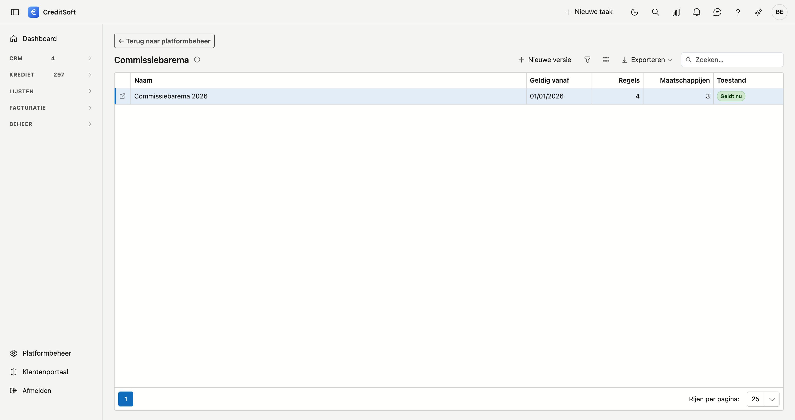

# Commissiebarema

Het barema is wat de maatschappijen uw kantoor betalen per afgesloten krediet: het percentage, de grenzen, de voorwaarden en het ritme waarin ze uitbetalen. CreditSoft rekent daarmee de commissie van een dossier voor, verdeelt ze over het aanbrengende kantoor en het hoofdkantoor, en berekent wat een maatschappij terugvraagt als een krediet vroeger eindigt.

Werkt uw kantoor niet met een barema, dan laat u dit scherm leeg. U ziet dan nergens een voorstel.

## Het scherm openen

Ga naar **Platformbeheer** onderaan het menu, en klik onder *Krediet* op de tegel **Commissiebarema**. U hebt daarvoor het recht om de commissie-instellingen te beheren.

{ .volle-breedte }

## Versies

Een barema verandert een paar keer per jaar. Elke wijziging is een nieuwe **versie** met een datum **Geldig vanaf**. Een versie geldt voor de dossiers met een **aktedatum** vanaf die datum, tot de volgende versie begint. Heeft een dossier nog geen akte, dan telt de indieningsdatum, en anders vandaag.

Zo rekent een dossier van vorig jaar met het barema van vorig jaar, ook nadat u een nieuwe versie hebt ingevoerd. Het label **Geldt nu** staat bij de versie die vandaag geldt.

### Een nieuwe versie

Klik op **Nieuwe versie**. U geeft een naam en de datum *Geldig vanaf*. Bij **Op basis van** kiest u een vorige versie: alle regels gaan dan mee, ook de trappen van de rentekorting en de terugvordering, en u past enkel aan wat wijzigde. Kiest u **Leeg beginnen**, dan voert u alle regels zelf in.

Klik in de lijst op een versie om haar regels te zien. Daar wijzigt u de naam, de datum en de opmerkingen, en met **Verwijderen** haalt u een versie weg. De dossiers waarvan de akte in die versie viel, rekenen dan met de vorige.

{ .volle-breedte }

## Een regel

Een regel is één maatschappij, of één **formule** van een maatschappij die er meer heeft (bijvoorbeeld *Formule A* en *Formule B*). Met **+ Regel toevoegen** maakt u er een; dubbelklik een regel om ze te wijzigen.

### Maatschappij en formule

- **Maatschappij** — de kredietinstelling, zoals op het dossier.
- **Formule** — enkel als de maatschappij meer regels heeft. Laat leeg als er maar één is.
- **Producten** — de producten waarvoor deze regel geldt. Een contract met zo'n product kiest deze regel dan zelf. Laat leeg om de regel voor elk product te laten gelden.

### De commissie

Kies **Percentage van het krediet**, **Vast bedrag** of **Ter info**.

- **Percentage** — van het kredietbedrag. Met *Gerekend op hoogstens* begrenst u het bedrag waarop gerekend wordt (bijvoorbeeld 1.000.000).
- **Vast bedrag** — één bedrag per krediet, ongeacht het kredietbedrag.
- **Minimum** en **maximum commissie** — grenzen op het resultaat.
- **Ter info** — de regel rekent niet; ze staat er voor wie het barema naleest. "Geen commissie" is een percentage van 0.

### Voorwaarden

Laat leeg wat niet telt. Een regel geldt enkel als **alle** ingevulde voorwaarden kloppen; ontbreekt een gegeven op het dossier (bijvoorbeeld de looptijd), dan geldt de regel niet.

- **Looptijd** en **rentevoet** — "vanaf" telt mee, "onder" niet. "Meer dan 7 jaar" is *vanaf 84 maanden*, "minder dan 7 jaar" is *onder 84*.
- **Indieningsdatum** en **aktedatum** — beide datums tellen mee.

### Uitbetaling door de maatschappij

Het ritme waarin de maatschappij uw kantoor betaalt. De commissieschema's van het kantoor en het hoofdkantoor volgen hetzelfde ritme.

- **Volgens de kredietinstelling** — het patroon op de fiche van de kredietinstelling.
- **Deel direct, rest gespreid** — een percentage de maand na de akte, de rest over een aantal maanden.
- **Geplande betalingen** — per betaling de maand na de akte en het deel. Samen 100 %.

### Rentekorting door commissieafstand

Bij sommige maatschappijen krijgt de klant een lagere rente als u een deel van uw commissie laat vallen. Elke **trap** zegt hoeveel punten commissie u afstaat en hoeveel punten rentekorting de klant krijgt. De kolom *Commissie wordt* toont wat er van het percentage overblijft.

- Voer een trap altijd in als **afstand in punten**, ook als de maatschappij een schaal toont. Toont ze *1,75 %* naast een basis van 2,25 %, dan is dat een afstand van 0,50.
- Heeft een trap een voorwaarde die u niet kan aanvinken (bijvoorbeeld *bij een eerste woning*), schrijf ze dan in **Voorwaarde**.
- Een trap bewaart **meteen**, los van de knop *Bewaren* onderaan. Een nieuwe regel bewaart u eerst; daarna voegt u de trappen toe.

Op het dossier kiest u daarna de afstand: zie [Kredietdossiers](../credit-management/credit-files.md#voorstel-volgens-het-barema).

### Terugvordering bij vervroegde terugbetaling of opeising

Wat de maatschappij terugvraagt als een krediet vroeger eindigt.

- **De nog niet betaalde gespreide commissie vervalt** — vink aan als de maatschappij de rest van de spreiding niet meer betaalt.
- **Trappen** — per trap: *binnen hoeveel maanden* na de akte, en hoe er gerekend wordt.
    - **Percentage** van **het uitbetaalde** (alles wat al betaald is) of van **het upfront-deel** (de eerste betaling).
    - **Pro rata** over een aantal maanden: het deel dat nog niet "verdiend" is gaat terug. De maand van de terugbetaling telt als niet verdiend.

"Binnen 12 maanden" telt op de datum: terugbetaald vóór de aktedatum plus 12 maanden. De eerste trap waarbinnen de terugbetaling valt, geldt. Geen trappen en geen vinkje betekent: geen recuperatie.

Wat niet te rekenen valt, zoals een terugvordering bij niet opgenomen kapitaal, schrijft u onderaan in **Terugvordering — toelichting**.

## Veelgemaakte fouten

!!! warning "Een barema met twee regels die allebei passen"
    Passen twee regels op hetzelfde krediet (bijvoorbeeld twee formules zonder product), dan kiest CreditSoft niet zelf. Op het dossier verschijnt dan *kies de formule*. Koppel producten aan de regels als u dat wil vermijden.

!!! warning "Een afstand groter dan het percentage"
    Een trap van 2,50 op een regel van 2,25 % wordt geweigerd. Kijk na of u de afstand of het nieuwe percentage invulde.

## Zie ook

- [Kredietdossiers — het voorstel volgens het barema](../credit-management/credit-files.md#voorstel-volgens-het-barema)
- [Te bevestigen commissies](../credit-management/commission-to-confirm.md)
- [Te bevestigen terugvorderingen](../credit-management/commission-clawback.md)
- [Commissie-instellingen](commissie-instellingen.md)
