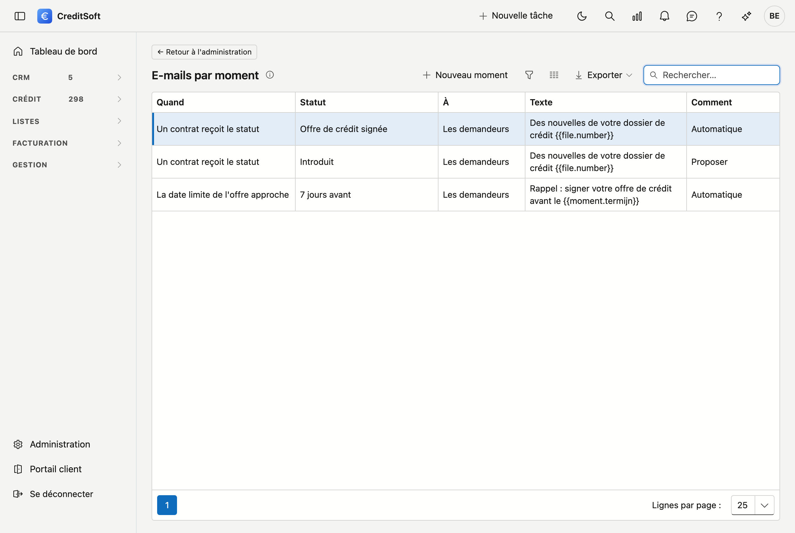
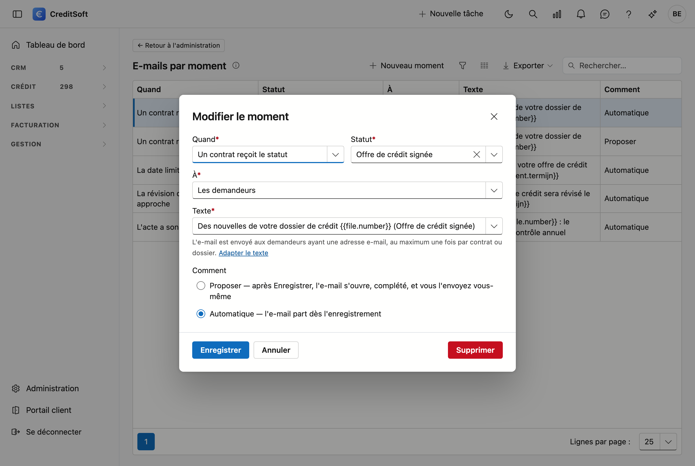
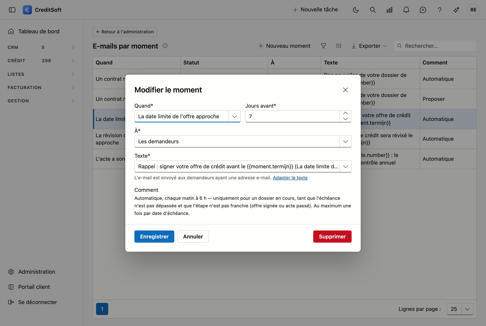

# E-mails par moment

Sur cet écran, vous déterminez quel e-mail votre client, l'**apporteur**, le **notaire**, l'**expert** ou l'**agence immobilière** reçoit lorsqu'un **contrat** ou le **dossier** reçoit un certain statut — par exemple un message indiquant que la demande a été introduite, ou que l'offre est disponible —, lorsque la **date de l'acte** est complétée, lorsqu'une **partie est désignée**, lorsqu'une **date limite** approche, ou pendant la durée du crédit : avant une **révision du taux** et à l'**anniversaire de l'acte**.

## Ouvrir l'écran

Dans la barre latérale, cliquez sur **Administration**, puis sur la tuile **E-mails par moment** (sous *Communication*).

## Configurer un moment

Avec **Nouveau moment** — ou un double-clic sur un moment existant — la fenêtre s'ouvre.

| Champ | Utilité |
|---|---|
| **Quand** | *Un contrat reçoit le statut* ou *Le dossier reçoit le statut* — si votre bureau travaille avec des statuts de contrat, choisissez le premier. Ou *La date de l'acte est complétée* : voir [La date de l'acte](#la-date-de-lacte). Ou *Une partie est désignée* : voir [Lors d'une désignation](#lors-dune-designation). Ou *La date limite de l'offre approche* ou *… de l'acte approche* : voir [Lors d'une date limite](#lors-dune-date-limite). Ou *La révision du taux d'un contrat approche* ou *L'acte a son anniversaire* : voir [Pendant la durée du crédit](#pendant-la-duree-du-credit). |
| **Statut** | Le statut auquel l'e-mail part. |
| **À** | *Les demandeurs* ou *L'apporteur* du dossier : voir [À l'apporteur](#a-lapporteur). Ou *Le notaire*, *L'expert* ou *L'agence immobilière* : voir [À un notaire, un expert ou une agence immobilière](#a-un-notaire-un-expert-ou-une-agence-immobiliere). |
| **Texte** | L'e-mail lui-même. Avec *Nouveau texte*, vous recevez un texte standard ; avec **Adapter le texte**, vous l'adaptez sous [Modèles d'e-mail](../administration/mail-templates.md). |
| **Comment** | **Proposer** : après *Enregistrer*, l'e-mail s'ouvre, complété, et vous l'envoyez vous-même. **Automatique** : l'e-mail part tout de suite. |

**Proposer** est le choix prudent : vous voyez d'abord l'e-mail. En mode **Automatique**, il part dès l'enregistrement, même si vous avez cliqué le statut par erreur.

## Ce qui se passe à l'enregistrement

Si vous enregistrez un contrat ou un dossier et qu'il reçoit un statut pour lequel un moment existe :

- l'e-mail est envoyé à qui figure sous **À** : **les demandeurs ayant une adresse e-mail**, **l'apporteur**, ou une **partie** du dossier ;
- il part **au maximum une fois** par contrat ou dossier — si vous remettez le statut puis le rétablissez, aucun deuxième ne suit ;
- il figure ensuite dans le **courrier** du dossier.

Enregistrer un dossier sans modifier son statut n'envoie rien. En mode *Proposer*, l'e-mail ne compte comme envoyé que lorsque vous l'envoyez réellement : si vous fermez la fenêtre, un changement suivant le proposera à nouveau.

## À l'apporteur

Choisissez sous **À** *L'apporteur* pour tenir l'apporteur du dossier informé : par exemple lorsque le dossier est introduit,
ou lorsque la date de l'acte est connue.

- L'apporteur ne reçoit l'e-mail **que si *E-mails par moment* est coché sur sa fiche** (bloc *Agrément et statut*, voir
  [Apporteurs](../crm/contributors.fr.md#agrement-et-statut)). Vous choisissez ainsi, apporteur par apporteur, qui reçoit ces
  messages. Si la case n'est pas cochée, rien ne part et aucun message n'apparaît.
- Si la case est cochée mais que l'apporteur n'a pas d'adresse e-mail, l'écran signale après *Enregistrer* que l'e-mail n'a pas pu partir.
- L'e-mail est rédigé dans la **langue des documents** de l'apporteur. Si elle n'est pas remplie, dans la langue de votre bureau.
- Avec *Nouveau texte*, vous recevez un texte standard pour l'apporteur : il mentionne le dossier et le client qu'il a apporté.

Pour envoyer, à un même moment, un e-mail au client et à l'apporteur, créez **deux moments** : l'un aux demandeurs, l'autre à
l'apporteur, chacun avec son propre texte.

## À un notaire, un expert ou une agence immobilière

Choisissez sous **À** *Le notaire*, *L'expert* ou *L'agence immobilière* pour écrire à une partie du dossier, par exemple au notaire
lorsque l'offre est disponible. Il s'agit des parties de l'onglet [Parties](../credit-management/credit-files.fr.md#parties) du
dossier.

- L'e-mail est envoyé à la partie de ce type qui est **désignée**. Si plusieurs sont désignées, elles figurent ensemble sous *À*. Si
  aucune n'est désignée, il est envoyé à toutes les parties de ce type.
- L'adresse est celle de la **personne de contact** sur la partie, sinon celle de la fiche du notaire, de l'expert ou de l'agence
  immobilière.
- L'e-mail est rédigé dans la **langue des documents** de ce professionnel, avec une formule d'appel neutre. Si elle n'est pas
  remplie, dans la langue de votre bureau.
- S'il n'y a aucune partie de ce type sur le dossier, ou si elle n'a d'adresse e-mail nulle part, l'écran signale après
  *Enregistrer* que l'e-mail n'a pas pu partir.
- Avec *Nouveau texte*, vous recevez un texte standard qui mentionne le dossier, le client et le statut.

## Lors d'une désignation

Si vous choisissez sous **Quand** *Une partie est désignée*, vous choisissez à côté **quelle partie** : notaire, expert ou agence
immobilière. L'e-mail part lorsque quelqu'un coche la case **Désigné** dans l'onglet *Parties* du dossier, aussi pour une nouvelle
partie enregistrée directement avec la case cochée.

- Si vous choisissez le même type sous **À**, l'e-mail est envoyé uniquement à la partie qui vient d'être désignée. Vous demandez
  ainsi une expertise dès que vous désignez l'expert : avec *Nouveau texte*, vous recevez un texte standard pour cela, avec
  l'adresse du bien.
- L'e-mail part **au maximum une fois par partie**. Si vous décochez puis cochez à nouveau la case, aucun deuxième ne suit.
- Sous **À**, vous pouvez aussi choisir *Les demandeurs*, pour informer votre client que le notaire ou l'expert est désigné.

## La date de l'acte

Si vous choisissez sous **Quand** *La date de l'acte est complétée*, l'e-mail part lorsque quelqu'un complète le champ *Date de
l'acte* sur le dossier, avec une date d'aujourd'hui ou plus tard. Il n'y a pas de statut à choisir.

- Une date **déplacée** n'envoie pas de nouvel e-mail : le message indiquant que la date est connue est déjà parti.
- Une date **dans le passé** n'envoie rien : c'est un acte déjà passé, pas une nouvelle.

## Lors d'une date limite

Si vous choisissez sous **Quand** *La date limite de l'offre approche* ou *La date limite de l'acte approche*, vous indiquez combien de **jours avant** l'e-mail part (7 par défaut). Il s'agit des champs *Date limite offre* et *Date limite acte* du dossier.

Un tel e-mail part toujours **automatiquement**, chaque matin à 6 h :

- uniquement pour un dossier **en cours**, et tant que la date n'est pas dépassée ;
- plus du tout si l'étape est franchie : pour l'offre si elle est signée (date de signature, *Offre signée envoyée*, ou l'acte est passé), pour l'acte s'il est passé ;
- **une fois par date** : si la date limite est prolongée, un nouvel e-mail suit pour la nouvelle date.

## Pendant la durée du crédit

Deux moments envoient un e-mail à votre client après la passation de l'acte, aux mêmes moments que les [signaux de gestion](beheersignalen.md) qui créent une tâche pour vos collaborateurs :

- **La révision du taux d'un contrat approche** : autant de **jours avant** que vous l'indiquez (60 par défaut), avant la prochaine révision d'un contrat à taux variable. Au maximum un e-mail par révision.
- **L'acte a son anniversaire** : à l'anniversaire de l'acte, chaque année tant que le crédit court. Un moment créé aujourd'hui n'envoie rien pour les anniversaires passés. Si la tournée n'a pas eu lieu un jour, l'e-mail part encore au plus 7 jours plus tard.

Ce sont des **e-mails commerciaux**, et des règles plus strictes s'appliquent donc que pour les autres moments :

- Ils partent toujours **automatiquement**, chaque matin à 6 h, et uniquement pour un **crédit en cours**.
- Ils vont uniquement aux **demandeurs**, et **chaque demandeur reçoit son propre e-mail**, avec sa formule d'appel et dans sa langue des documents.
- Sous chaque e-mail figure un **lien de désinscription**. Qui clique dessus reçoit sur sa [fiche de relation](../crm/relations.md) la coche *Pas d'e-mail groupé* et ne reçoit plus ces e-mails ni vos e-mails groupés.
- Qui porte déjà cette coche, ou dont l'adresse est marquée comme non valable, ne reçoit rien. Deux demandeurs avec la même adresse reçoivent ensemble un seul e-mail.
- Si votre environnement ne laisse partir aucun e-mail (une démo ou une formation), rien ne part.

Avec *Nouveau texte*, vous obtenez un texte standard qui s'adresse au client avec sa formule d'appel et l'invite à revoir ensemble le prêt et les assurances. Pour la révision, `{{moment.termijn}}` contient la date de la révision ; pour l'anniversaire, l'anniversaire lui-même.

!!! tip "Variables pour ces textes"
    Dans le texte, vous pouvez notamment utiliser `{{client.firstnames}}` (les prénoms des clients), `{{file.applicants}}` (les noms des demandeurs), `{{file.institution}}` (l'institution de crédit — pour un moment de contrat, celle du contrat), `{{file.amount}}`, `{{file.number}}`, `{{file.deeddate}}` (la date de l'acte), `{{moment.status}}` (le statut qui a déclenché l'e-mail) et `{{moment.termijn}}` (la date limite, pour une échéance). Dans un e-mail à l'apporteur ou à une partie, `{{recipient.name}}` désigne son nom et `{{recipient.greeting}}` la formule d'appel. Pour le bien et les parties : `{{property.address}}` (l'adresse du bien), `{{notary.name}}`, `{{notary.email}}` et `{{notary.phone}}`, et de même avec `valuator` pour l'expert et `realestate` pour l'agence immobilière.
