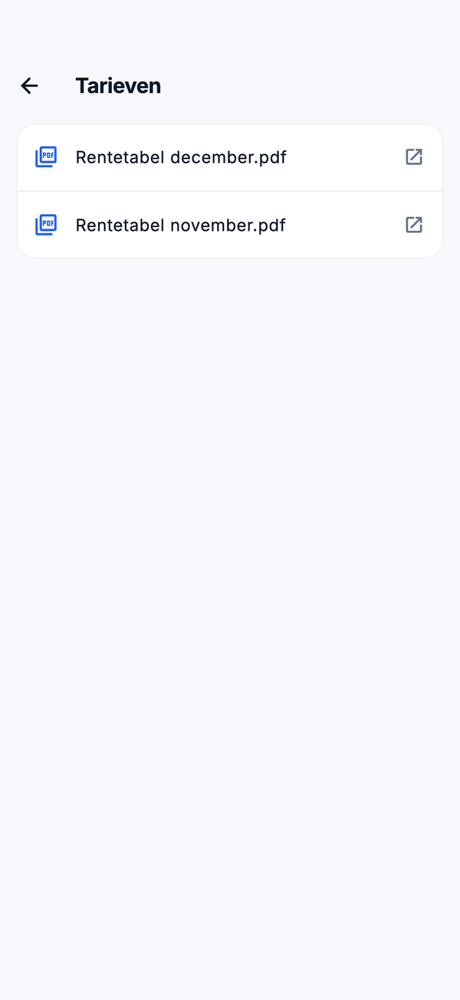

# De mobiele app

Met de CreditSoft-app op uw iPhone of Android-telefoon heeft u uw dossiers ook bij de hand als u niet op kantoor bent: bij de
klant, bij de notaris of tussen twee afspraken. De app werkt op dezelfde gegevens als CreditSoft op kantoor —
wat u in de app doet, staat meteen ook daar.

[Download de app in de App Store](https://apps.apple.com/be/app/creditsoft/id6748912369){ .md-button .md-button--primary target="_blank" rel="noopener" }
[Download de app op Google Play](https://play.google.com/store/apps/details?id=com.admconcept.creditsoft){ .md-button .md-button--primary target="_blank" rel="noopener" }

## Voor wie

De app is er voor twee soorten gebruikers, en beide melden zich aan met hun **gewone CreditSoft-account**:

- **Medewerkers van het kantoor** zien alle dossiers van het kantoor, zoals op de computer.
- **Aanbrengers** zien enkel hun eigen dossiers en de klanten die zij zelf aanbrachten. Een aanbrenger kan
  inloggen zodra het kantoor hem toegang gaf; dat gebeurt op zijn fiche, zoals beschreven bij
  [het aanbrengersportaal](../portaal/index.md).

Een account aanmaken kan niet in de app zelf. Heeft u er nog geen, vraag het dan aan uw kantoor.

## Aanmelden

1. Vul uw **gebruikersnaam of e-mail** en uw **wachtwoord** in.
2. Tik op **Aanmelden**.

U blijft daarna aangemeld op dat toestel. Moet u zich toch opnieuw aanmelden, dan staat uw gebruikersnaam al ingevuld
en typt u enkel uw wachtwoord.

### Met tweestapsverificatie

Heeft u [tweestapsverificatie](tweestapsverificatie.md) aangezet, dan vraagt de app na uw wachtwoord een **code**:

- Gebruikt u een **authenticator-app**, dan vult u de code uit die app in.
- Krijgt u de code **per mail**, dan stuurt CreditSoft ze naar uw mailadres. Geen mail ontvangen? Kijk ook in uw
  ongewenste mail, of tik op **Geen mail ontvangen? Stuur een nieuwe code**. Een nieuwe code kan pas een minuut na de
  vorige.

Tik daarna op **Verifiëren**.

Heeft u uw authenticator-app of uw mail niet bij de hand, tik dan op **App niet beschikbaar? Gebruik een herstelcode**
(bij een code per mail: **Geen toegang tot uw mail? Gebruik een herstelcode**) en vul een van uw
[herstelcodes](tweestapsverificatie.md#herstelcodes) in. Met **Opnieuw aanmelden** gaat u terug naar uw wachtwoord.

!!! note "Een passkey werkt niet in de app"
    Meldt u zich op de computer aan met een passkey, dan gebruikt u in de app uw wachtwoord en daarna de code.

## Home

{ .eigen-breedte style="width:280px" }

Bovenaan ziet u uw cijfers: hoeveel dossiers, het **kredietbedrag van de aktes van dit jaar**, hoeveel dossiers er dit
jaar bij kwamen en hoeveel aktes er dit jaar zijn. Het kredietbedrag telt dezelfde aktes als *Afgesloten kredieten* in
[het aanbrengersportaal](../portaal/overzicht.md).

Daaronder, van boven naar onder:

- **Mededelingen**: wat uw kantoor u wil laten weten (zie [Mededelingen](#mededelingen)).
- **Klant aanbrengen** en **Dossier zoeken**: de twee dingen die u onderweg het vaakst doet.
- **Op te volgen**: de dossiers die nu iets van u vragen (zie [Op te volgen](#op-te-volgen)).
- **Volgende afspraak**: uw eerstvolgende afspraak, met dag, uur, onderwerp en klant.
- **Mijn commissies** en **Documenten van het kantoor**, voor aanbrengers (zie [Mijn commissies](#mijn-commissies) en
  [Documenten van het kantoor](#documenten-van-het-kantoor)).

Met het menu linksboven gaat u naar **Dossiers**, naar de klanten die u **Aangebracht** heeft, en naar uw
**Afspraken** per dag. Trek de startpagina naar beneden om alles te vernieuwen.

!!! note "Vanaf versie 1.4.0 van de app"
    Ziet u de mededelingen, Op te volgen, Mijn commissies of Documenten van het kantoor nog niet, werk de app dan bij
    in de App Store of op Google Play.

## Mededelingen

Bovenaan de startpagina staan de mededelingen van uw kantoor, dezelfde als in het aanbrengersportaal. Een aanbrenger
leest de mededelingen voor aanbrengers, een medewerker die voor medewerkers. Het kantoor schrijft ze bij
[Mededelingen](../beheer/mededelingen.md).

Een **vastgepinde** mededeling (met de punaise) staat bovenaan en is open. De andere tonen enkel hun titel en datum:
tik erop om de tekst te lezen, en nog eens om ze te sluiten. Een **waarschuwing** staat in het rood.

Heeft uw kantoor geen mededelingen lopen, dan staat er geen blok.

## Op te volgen

{ .eigen-breedte style="width:280px" }

Onder **Snel naar** staat wat er nu te doen is, per dossier, zoals het blok Op te volgen op
[het overzicht van het aanbrengersportaal](../portaal/overzicht.md):

- de **termijnen** die verstreken zijn (in het rood, met *verstreken*) of binnen het venster van uw kantoor vallen,
  bijvoorbeeld een akte of een offerte die getekend moet worden;
- de **stukken** die nog **te bezorgen** zijn, en die **geweigerd** werden.

Naast de titel leest u hoe ver het venster reikt, bijvoorbeeld *termijnen tot 14 dagen vooruit*.

Het dringendste staat bovenaan. Tik een dossier aan om het te openen: daar levert u een stuk meteen aan (zie
[Een document fotograferen](#een-document-fotograferen)). Het blok toont hoogstens tien dossiers; staan er meer, dan
brengt **Nog … dossiers** u naar **Dossiers**. Een termijn waarvan de stap al gezet is, en een dossier dat afgesloten
is, staan er niet. Een stuk dat u aanleverde en dat op beoordeling wacht, telt niet mee.

Wie wat ziet:

- Een **aanbrenger** ziet zijn eigen dossiers, en ook die van een collega die hij tijdelijk vervangt. Heeft het kantoor
  de documenten voor hem uitgezet, dan toont het blok enkel de termijnen.
- Een **medewerker** ziet enkel de dossiers die aan hem toegewezen zijn. Hangt er geen medewerkersfiche aan zijn
  account, dan staat er geen blok.

Is er niets te doen, dan zegt het blok dat.

## Afspraken

Onder **Afspraken** staan de afspraken van deze maand, per dag. Elke afspraak toont het uur, de plaats en met wie ze is:

- **Klant** — de klant, of de prospect, of wie de afspraak online boekte;
- **Aanbrenger** — de aanbrenger die bij de afspraak hoort;
- **Medewerker** — de collega('s) van het kantoor die op de afspraak staan.

Werkt u op kantoor, dan ziet u de afspraken van het hele kantoor. Staan er afspraken van meerdere collega's, dan kiest
u bovenaan **Iedereen**, **Mijn afspraken** of één collega. Ook bij **Volgende afspraak** op de startpagina staat de
klant erbij.

!!! note "Vanaf versie 1.2.0 van de app"
    Ziet u de klant en de medewerker nog niet bij uw afspraken, werk de app dan bij in de App Store of op Google Play.

## Een dossier opzoeken en openen

Onder **Dossiers** zoekt u op de naam van de klant, het dossiernummer of het contractnummer. Tik een dossier
aan om het te openen.

{ .eigen-breedte style="width:280px" }

Het dossier toont de klant, het kredietbedrag en de status, de kredietgever en het contractnummer, en de
**dossierbeheerder**. Die belt of mailt u meteen met **Bellen** of **Mailen**.

Onder **Documenten** staat per stuk hoe het ervoor staat: **Te bezorgen**, **Goedgekeurd** of **Geweigerd**.
Bij een geweigerd stuk staat de reden erbij, zodat u weet wat er anders moet.

## Een document fotograferen

{ .eigen-breedte style="width:280px" }

Tik in een dossier op een stuk dat nog te bezorgen of geweigerd is. Dan kunt u:

- **Foto nemen** — één foto per bladzijde of per kant. Alle foto's samen worden **één pdf**.
- **Uit de galerij** — een foto kiezen die al op uw telefoon staat.
- **Pdf kiezen** — een pdf die al op uw telefoon staat.

Een bladzijde die niet goed is, haalt u weg met het kruisje. Tik daarna op **Versturen**. Het stuk komt op
kantoor binnen bij [Te valideren](../credit-management/document-validation.md); wordt het geweigerd, dan ziet
u dat in de app, met de reden.

Foto's die u in de app neemt, komen niet in de fotogalerij van uw telefoon terecht. Samen mogen de foto's van
één stuk niet groter zijn dan 20 MB.

## Een klant aanbrengen

{ .eigen-breedte style="width:280px" }

Met **Klant aanbrengen** geeft u iemand door aan het kantoor. Vul minstens een **naam** in, en een
**telefoonnummer** of **e-mailadres**. De soort vraag, een indicatief bedrag en een opmerking helpen het kantoor
om de klant meteen goed te woord te staan.

Vink aan dat **de klant akkoord gaat** om gecontacteerd te worden, en tik op **Doorgeven aan kantoor**. Op
kantoor komt de klant binnen als [lead](../crm/leads.md).

Onder **Aangebracht** volgt u hoe het ermee staat: **Nieuw**, **In behandeling**, **Klant geworden** of **Niet
doorgegaan**.

## Mijn commissies

{ .eigen-breedte style="width:280px" }

Voor **aanbrengers**, als uw kantoor commissies in het portaal toont (zie [Mijn commissies](../portaal/commissies.md)
in het aanbrengersportaal). Anders staat de tegel er niet.

De tegel op de startpagina toont het totaal van het jaar. Tik erop voor:

- het **jaar**: bovenaan kiest u een ander jaar. Enkel jaren met commissie staan erbij. Het scherm opent op dit jaar,
  of op het laatste jaar met commissie.
- het **totaal** van dat jaar, en hoeveel daarvan **uitbetaald** is: wat op een betaald borderel staat. Commissie wordt
  vooruit geboekt, dus ook wat later in het jaar vervalt, telt mee. Gaf u zelf commissie door aan uw makelaars, dan
  staat eronder hoeveel; dat telt niet mee in het totaal.
- **Per maand**: het bedrag en het aantal boekingen.
- **Borderellen**: elk borderel met zijn datum, zijn bedrag en of het al **betaald** is. Tik een borderel aan om het
  als pdf te openen (zie [Een bestand openen](#een-bestand-openen)).

## Documenten van het kantoor

{ .eigen-breedte style="width:280px" }

Voor **aanbrengers**: de documenten die uw kantoor met u deelt, dezelfde als bij [Documenten](../portaal/documenten.md)
in het aanbrengersportaal. Heeft uw kantoor de documenten voor u uitgezet, dan staat de tegel er niet.

De tegel toont hoeveel bestanden er zijn. Tik erop voor de mappen; een map kan submappen hebben. Tik een bestand aan
om het te openen.

## Een bestand openen

Een borderel of een document van het kantoor opent in de viewer van uw telefoon: op een iPhone in een voorbeeld
bovenop de app, op Android in de pdf-app van uw telefoon. Van daaruit kunt u het delen of bewaren. Een bestand dat uw
telefoon niet zelf toont, opent in een andere app; is er geen, dan zegt de app dat.

Het bestand blijft niet in de app: ze wist het zodra u het voorbeeld sluit (iPhone) of naar de app terugkeert
(Android), en zeker bij afmelden. Bewaart of deelt u het zelf, dan staat het daar wel.

## Ontgrendelen met Face ID of vingerafdruk

Tik op uw initialen rechtsboven en zet **Ontgrendelen met Face ID of vingerafdruk** aan. De app vraagt dan meteen één
keer uw gezicht of vingerafdruk; pas als dat lukt, staat het aan.

Daarna vraagt de app het telkens als u ze opent, en als u terugkomt na vijf minuten of meer in een andere app. Wordt u
niet herkend, tik dan op **Opnieuw proberen**, of op **Opnieuw aanmelden** om u aan te melden met uw wachtwoord.

Heeft uw telefoon geen Face ID of vingerafdruk ingesteld, dan staat de schakelaar grijs, met de reden eronder. De keuze
geldt voor dit toestel; afmelden zet ze niet uit.

## Taal en weergave

Staat uw telefoon in het Frans, dan is de app Frans; anders is ze Nederlands. Gebruikt uw telefoon de donkere
modus, dan doet de app dat ook.

Afmelden doet u met een tik op uw initialen rechtsboven, en dan onderaan **Afmelden**. U wordt afgemeld op dat
toestel.
