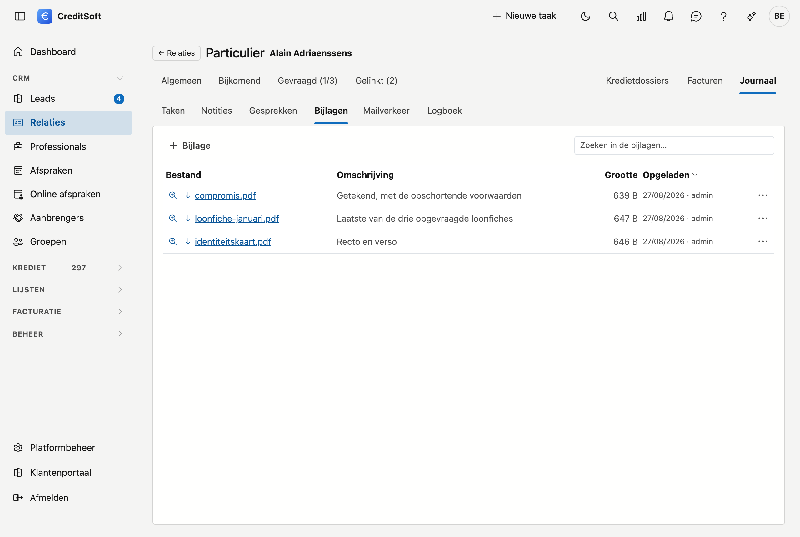

# Bijlagen

Onder **Bijlagen** bewaart u de bestanden die bij een fiche horen: een identiteitskaart, een loonfiche, een
getekende offerte, een plan. Ze blijven bij de fiche staan, ook wanneer degene die ze opgeladen heeft er niet
meer is.

## Bestanden opladen

Klik **Toevoegen**. In het venster dat opent:

1. Geef eventueel een **omschrijving** — waarvoor het document dient. Dat is handiger dan een bestandsnaam als
   *scan0012.pdf*.
2. **Sleep** de bestanden naar het gemarkeerde vak, of klik erop om ze te kiezen. U kunt er **meerdere tegelijk**
   opladen; ze verschijnen in een lijstje dat u nog kan bijwerken vóór u bewaart.
3. Klik **Bewaren**.

!!! warning "Maximaal 25 MB per bestand"
    Grotere bestanden worden geweigerd. Een scan die over die grens gaat, is meestal op een te hoge resolutie
    gemaakt — scan opnieuw op een lagere instelling, of splits het document.

## Wat u in de lijst ziet

Op een fiche staan de bijlagen in een tabel met **Naam**, **Omschrijving**, **Grootte** en **Opgeladen op**.

Werkt u in de **zijlade** naast een lijst, dan is er te weinig plaats voor kolommen. Daar krijgt elke bijlage
een eigen blok: bovenaan de bestandsnaam, daaronder grootte en datum op één regel, en daaronder de
omschrijving over de volle breedte. Het **⋯**-menu staat rechtsboven in het blok. U ziet dezelfde gegevens,
onder elkaar in plaats van naast elkaar, en u hoeft niet zijwaarts te schuiven.

Een lange bestandsnaam of een lange omschrijving breekt over meerdere regels.

## Een bijlage openen

- **Klik op de bestandsnaam** om het bestand te downloaden.
- Een **PDF**, een **foto**, een **Word**- of **Excel**-bestand en een **mail** (een `.eml`- of `.msg`-bestand,
  bijvoorbeeld een mail die u uit Outlook opsloeg) kunt u ook **bekijken** zonder ze eerst te downloaden: met het
  vergrootglas vóór de bestandsnaam, of met **Bekijken** in het menu rechts. Het bestand opent in een venster in
  CreditSoft zelf. Voor andere bestandssoorten is downloaden de weg.
- Een **Word**- of **Excel**-bestand toont CreditSoft als PDF. De opmaak kan daarbij wat afwijken van het origineel;
  boven het venster staat dat ook. Wilt u het echte bestand, download het dan. Een Excel-blad wordt eerst
  herberekend, zodat een formule haar uitkomst toont. Een bestand boven 20 MB kunt u enkel downloaden.
- Bij een **mail** ziet u de afzender, de ontvangers, de datum, het onderwerp, de tekst en de bijlagen van de mail.
  Foto's die als losse bijlage bij de mail zitten, staan als miniatuur onder de tekst. Een PDF of foto uit de mail
  opent in hetzelfde venster; een andere bijlage wordt gedownload. Beelden die van
  buitenaf geladen zouden worden, laadt CreditSoft niet, zodat de afzender niet ziet dat u de mail opende. Boven de
  mail staat dan hoeveel beelden er weggelaten zijn.

## Aanpassen of verwijderen

In het menu rechts van elke bijlage staat **Omschrijving aanpassen** — de omschrijving verandert, het bestand
zelf niet — en **Verwijderen**, met een bevestiging. Verwijderde bijlagen komen in de
[Prullenbak](../administration/recycle-bin.md).

## Op een dossier: de bijlagen van de aanvragers

Op een **kredietdossier** staan onder de eigen bijlagen ook de **Bijlagen van de aanvragers**: de bestanden op de relatiefiche van elke aanvrager, per aanvrager. U ziet ze en opent ze vanaf het dossier, maar u beheert ze op de relatiefiche — hier kunt u er niets opladen, hernoemen of verwijderen. Zo blijft één bestand bij de klant, ook als hij in meerdere dossiers aanvrager is.

## Zoeken en exporteren

Het **zoekveld** filtert de lijst terwijl u typt. De knop ernaast exporteert de lijst naar **Excel** of **CSV**.
Dat is de lijst van bijlagen, niet de bestanden zelf.

## Bijlagen meesturen met een mail

Wat hier staat, kunt u rechtstreeks meesturen wanneer u vanuit het journaal een mail opstelt: in het
[Mailverkeer](mailverkeer.md) kiest u de bijlagen van deze fiche aan met een vinkje. U hoeft ze dus niet eerst
te downloaden om ze weer op te laden.
