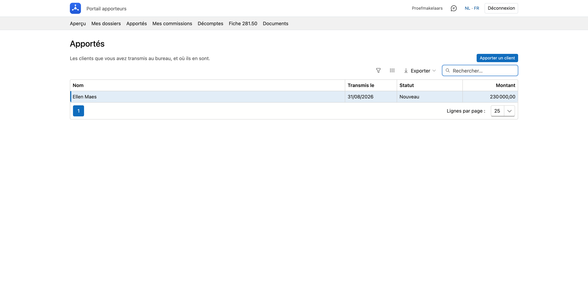
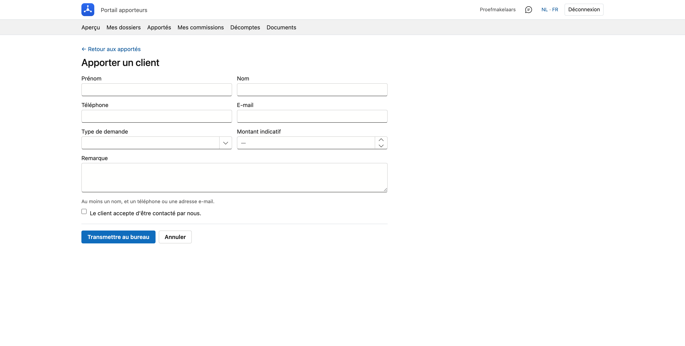

# Apportés

Les clients que vous avez transmis au bureau, et où ils en sont. C'est aussi ici que vous transmettez un nouveau client.

## Ouvrir l'écran

Dans le portail, cliquez en haut sur **Apportés**.

## La liste

Par client apporté, vous voyez le **nom**, la date à laquelle vous l'avez **transmis**, le **statut** et le **montant**.
Le plus récent figure en haut. Vous pouvez rechercher, trier et exporter la liste.

Le statut indique où en est le bureau :

| Statut | Ce que cela signifie |
|---|---|
| **Nouveau** | Le bureau a reçu le client et ne l'a pas encore pris en charge. |
| **En cours** | Le bureau s'occupe du client. |
| **Devenu client** | Le client poursuit avec le bureau. |
| **Sans suite** | Cela n'a pas abouti. |

Vous ne voyez pas ici qui suit le client au bureau, ni pourquoi une demande n'a pas abouti.

Si vous êtes apporteur principal et que votre bureau l'a réglé ainsi, vous voyez aussi ici les clients apportés par vos
bureaux et collaborateurs — la même portée que dans [Mes dossiers](dossiers.md).

## Apporter un client

Cliquez en haut à droite sur **Apporter un client**. Le formulaire s'ouvre sur sa propre page ; avec **Annuler** ou le lien en haut, vous revenez à la liste sans rien transmettre.

Complétez ce que vous savez :

- un **prénom** ou un **nom** — au moins l'un des deux ;
- un **téléphone** ou une **adresse e-mail** — au moins l'un des deux ;
- le **type de demande** (crédit logement, refinancement, crédit à la consommation ou autre), un **montant indicatif**
  et une **remarque**, si vous les connaissez.

Cochez ensuite que **le client accepte d'être contacté par le bureau**. Sans cet accord, vous ne pouvez pas transmettre :
vous communiquez les données de quelqu'un d'autre, et cela n'est permis qu'avec son consentement.

Cliquez sur **Transmettre au bureau**. S'il manque quelque chose, ou si une adresse e-mail ou un numéro de téléphone
n'est pas valide, l'écran vous le signale. Sinon, le client figure aussitôt dans votre liste avec le statut *Nouveau*,
et le bureau prend contact avec lui.

!!! info "Aussi dans l'application mobile"
    Dans l'[application mobile](../getting-started/mobiele-app.md), vous faites de même sous **Apportés**. Ce que vous
    transmettez dans l'application figure aussi ici, et inversement.

!!! note "Pour le bureau"
    Un client qu'un apporteur transmet ici arrive dans l'écran [Leads](../crm/leads.md#leads-dun-apporteur), avec
    l'apporteur et la provenance **Portail apporteurs**.
