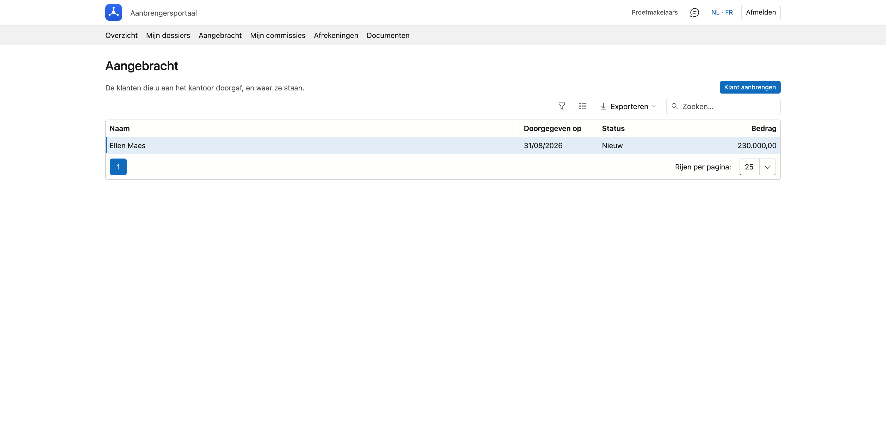
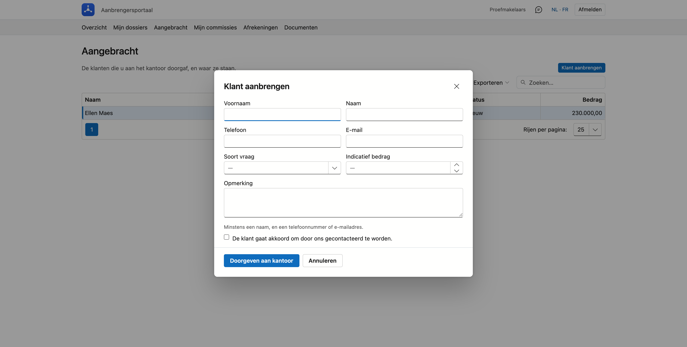

# Aangebracht

De klanten die u aan het kantoor doorgaf, en waar ze staan. Hier geeft u ook een nieuwe klant door.

## Het scherm openen

Klik in het portaal bovenaan op **Aangebracht**.

## De lijst

Per aangebrachte klant ziet u de **naam**, de datum waarop u hem **doorgaf**, de **status** en het **bedrag**. De
nieuwste staat bovenaan. U kunt zoeken, sorteren en de lijst exporteren.

De status zegt hoe ver het kantoor staat:

| Status | Wat het betekent |
|---|---|
| **Nieuw** | Het kantoor heeft de klant ontvangen en nog niet opgepakt. |
| **In behandeling** | Het kantoor is met de klant bezig. |
| **Klant geworden** | De klant werkt verder met het kantoor. |
| **Niet doorgegaan** | Het is er niet van gekomen. |

Wie de klant bij het kantoor opvolgt en waarom iets niet doorging, staat hier niet.

Bent u hoofdaanbrenger en heeft uw kantoor dat zo ingesteld, dan staan hier ook de klanten die uw kantoren en
medewerkers aanbrachten — dezelfde reikwijdte als in [Mijn dossiers](dossiers.md).

## Een klant aanbrengen

Klik rechtsboven op **Klant aanbrengen**.

Vul in wat u weet:

- een **voornaam** of **naam** — minstens één van de twee;
- een **telefoonnummer** of **e-mailadres** — minstens één van de twee;
- de **soort vraag** (woonkrediet, herfinanciering, consumentenkrediet of andere), een **indicatief bedrag** en een
  **opmerking**, als u die kent.

Vink daarna aan dat **de klant akkoord gaat om door het kantoor gecontacteerd te worden**. Zonder dat akkoord kunt u
niet doorgeven: u geeft de gegevens van iemand anders door, en dat mag enkel met zijn toestemming.

Klik op **Doorgeven aan kantoor**. De klant staat meteen in uw lijst met de status *Nieuw*, en het kantoor neemt
contact met hem op.

!!! info "Ook in de mobiele app"
    In de [mobiele app](../getting-started/mobiele-app.md) doet u hetzelfde onder **Aangebracht**. Wat u in de app
    doorgeeft, staat ook hier, en omgekeerd.

!!! note "Voor het kantoor"
    Een klant die een aanbrenger hier doorgeeft, komt binnen op het scherm [Leads](../crm/leads.md#leads-van-een-aanbrenger),
    met de aanbrenger erbij en als herkomst **Aanbrengersportaal**.
