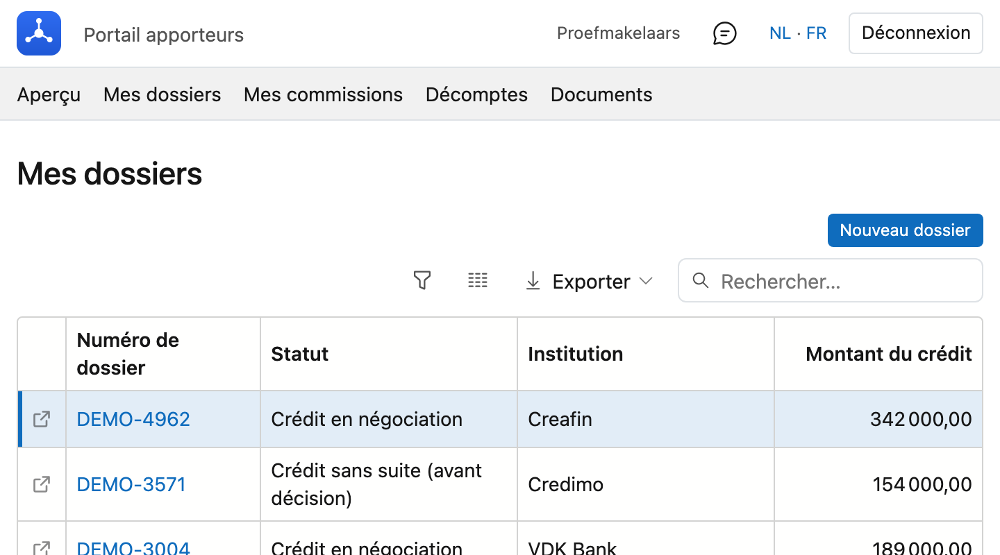
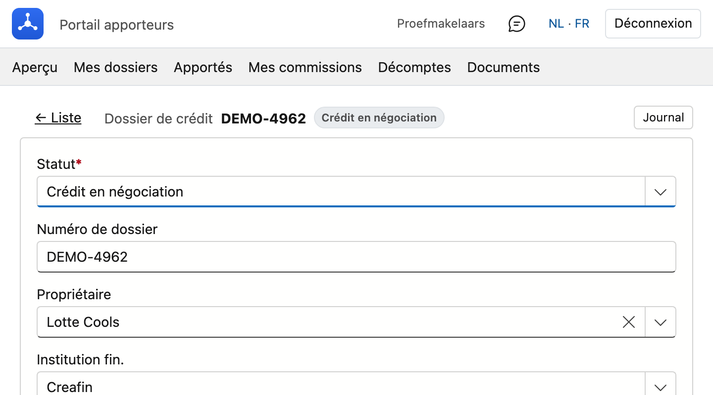
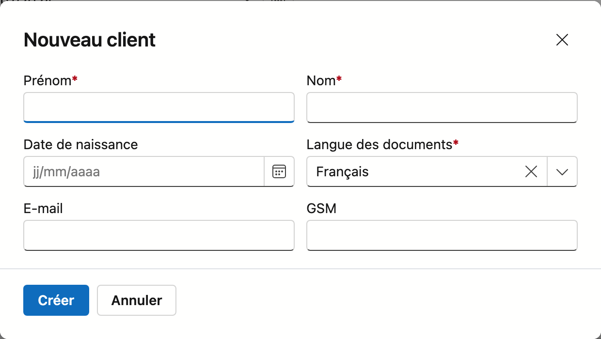
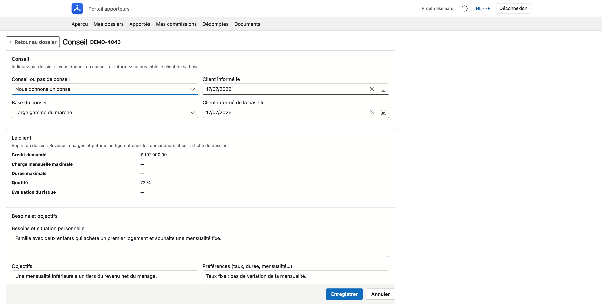

# Mes dossiers

Les dossiers dans lesquels vous figurez comme apporteur.

## Ouvrir l'écran

Dans le portail, cliquez en haut sur **Mes dossiers**.

## La liste

Au-dessus de la liste figure le nombre de dossiers. Par dossier, vous voyez le **numéro**, le **demandeur**,
le **statut**, l'**organisme** et le **montant du crédit**.

En haut à droite se trouve un **champ de recherche**. Tapez une partie d'un numéro de dossier, du nom d'un
demandeur ou d'un organisme et la liste se réduit immédiatement. Vous pouvez également trier et filtrer par colonne, et
exporter la liste.

Si votre bureau vous autorise à introduire vous-même des dossiers, le bouton **Nouveau dossier** figure en haut à
droite, même tant que vous n'avez encore aucun dossier : le dossier est créé immédiatement à votre nom et s'ouvre
comme fiche.

Si vous êtes apporteur principal et que votre bureau l'a configuré ainsi, les dossiers des bureaux et
collaborateurs qui dépendent de vous apparaissent également ici. Sinon, vous ne voyez que les vôtres.

Cliquez sur un numéro de dossier pour l'ouvrir. Avec **Ctrl-clic** (Cmd sur un Mac), la molette ou la **flèche** en début de ligne, il s'ouvre dans un **nouvel onglet** de votre navigateur ; la liste reste affichée.

## Ouvrir un dossier

Le dossier s'ouvre sur une page distincte, avec le même contenu que celui que voit votre bureau : les
données du crédit, le bien, les demandeurs, les contrats, les parties concernées et le journal.

Vous pouvez aussi **mettre à jour** les dossiers de votre liste : l'écran fonctionne comme dans le back-office,
vous adaptez et cliquez sur **Enregistrer**. Cela vaut aussi pour les dossiers des bureaux qui dépendent de vous.
Les remarques internes et la commission de votre bureau ne vous sont pas affichées.

Le champ **Apporteur** ne propose que votre propre bureau et les bureaux qui dépendent de vous. Si aucun bureau ne
dépend de vous, il reste fixé à votre nom.

## Lier un client à un dossier

Sous **Demandeurs de crédit**, cliquez sur **+ Lier un demandeur** et choisissez le client dans la liste. La liste
affiche les clients des dossiers de votre bureau et des bureaux qui dépendent de vous, pas ceux d'autres bureaux.

Votre client n'y figure pas encore ? Cliquez alors sur **+ Nouveau client** sous la liste.

{ .volle-breedte }

| Champ | À quoi il sert |
|---|---|
| **Prénom**, **Nom** | Obligatoires |
| **Date de naissance** | Aide votre bureau à distinguer deux clients portant le même nom |
| **Langue des documents** | La langue dans laquelle le client reçoit courriers et e-mails |
| **E-mail**, **GSM** | Facultatifs, mais vérifiés : une adresse ou un numéro incomplet est refusé |

Cliquez sur **Créer**. Le client est aussitôt sélectionné ; **Enregistrer** le lie au dossier.

!!! info "Un client déjà connu de votre bureau"
    Si votre client est déjà connu d'un autre bureau, vous ne le voyez pas dans la liste, et CreditSoft ne vous
    dit pas non plus qu'il existe. Créez-le sans crainte : votre bureau fusionne les clients en double.

## Les onglets à droite

À droite du dossier se trouvent des onglets. Ceux que vous voyez dépendent du dossier et de vos droits.

**Parties concernées** — notaire, expert, architecte et autres tiers liés à ce dossier.

**Remarques** — les remarques qui accompagnent le dossier.

**Documents** — l'état de la liste de contrôle : quelle pièce est **présente**, **validée**, **refusée** ou
**encore à fournir**.

**Demander des documents** — pour réclamer directement à votre client les pièces manquantes. Voir
[Demander des documents](#demander-des-documents-a-votre-client) ci-dessous.

**Reverser une commission** — uniquement si vous percevez vous-même une commission sur ce dossier et que
vous travaillez avec vos propres courtiers. Voir [Décomptes à mes courtiers](afrekeningen.fr.md).

## Le conseil

Si votre bureau est autorisé à introduire lui-même des dossiers, vous enregistrez aussi le **conseil** sur un dossier : si
vous donnez un conseil, sur quelle base, ce dont le client a besoin, quels crédits vous avez comparés et ce que vous
proposez. Cela fonctionne comme pour votre bureau, voir [Conseil](../credit-management/advice.md). Vous l'ouvrez en bas du
dossier, dans l'onglet **Conseil**. Un apporteur qui ne fait qu'apporter des clients ne voit pas cet onglet.

{ .volle-breedte }

**La copie pour le client.** **+ Établir une copie** produit la comparaison de crédits en pdf. En haut figure l'en-tête de
votre groupe, avec en dessous **votre bureau comme interlocuteur** : nom, adresse, téléphone, e-mail et votre numéro FSMA,
tels qu'ils figurent sur votre fiche. Si quelque chose ne va pas, demandez à votre bureau d'adapter votre fiche.

**Envoyer** expédie la copie depuis votre **propre adresse e-mail**, pour que la réponse du client vous parvienne. Comme pour
la [demande de documents](#demander-des-documents-a-votre-client), cela n'est possible que depuis une adresse sur un domaine
enregistré de votre bureau. Sinon, la raison s'affiche sous les copies, et vous remettez la copie **sur papier** ou la
faites envoyer par votre bureau.

## Demander des documents à votre client

Dans l'onglet **Demander des documents**, vous choisissez le demandeur dans la liste et cliquez sur
**Envoyer la demande**. Votre client reçoit un lien lui permettant de téléverser ses pièces.

Le lien apparaît aussi à l'écran — pratique pour qui préfère le communiquer par téléphone.

!!! info "La demande vient de vous, pas du bureau"
    Votre client voit votre propre adresse e-mail comme expéditeur, et sa réponse vous parvient donc
    directement.

!!! warning "Pourquoi le bouton est parfois absent"
    Un e-mail ne peut partir que d'un domaine enregistré à cet effet. Ce n'est pas un réglage de CreditSoft
    mais une sécurité d'internet lui-même : elle empêche d'envoyer du courrier au nom d'autrui.

    Si votre adresse relève du domaine de votre bureau, cela fonctionne immédiatement. Si elle relève d'un
    domaine propre ou d'une adresse générique comme Gmail, vous lisez brièvement pourquoi ce n'est pas
    possible. Votre bureau peut faire enregistrer ce domaine.

## Retour à la liste

En haut à gauche se trouve **Liste**. Votre recherche et votre tri sont conservés : vous revenez là où vous
étiez.

!!! info "Un dossier que vous n'avez pas le droit de voir"
    Si vous ouvrez un dossier hors de votre périmètre, vous obtenez *« Ce dossier n'est pas disponible. »*
    C'est la même limite que celle de la liste : ce qui n'y figure pas ne s'ouvre pas non plus via la barre
    d'adresse.

## Voir aussi

- [Mes commissions](commissies.fr.md)
- [Décomptes à mes courtiers](afrekeningen.fr.md)
