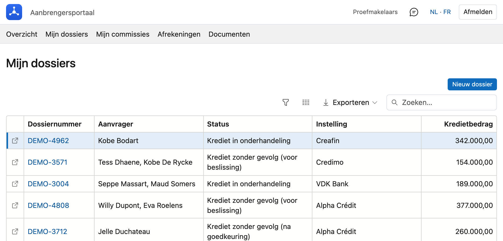
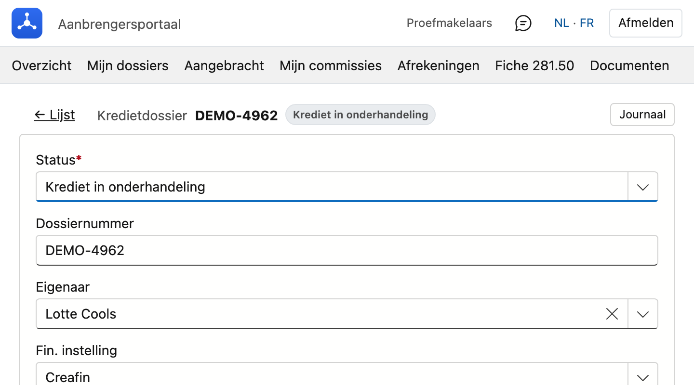
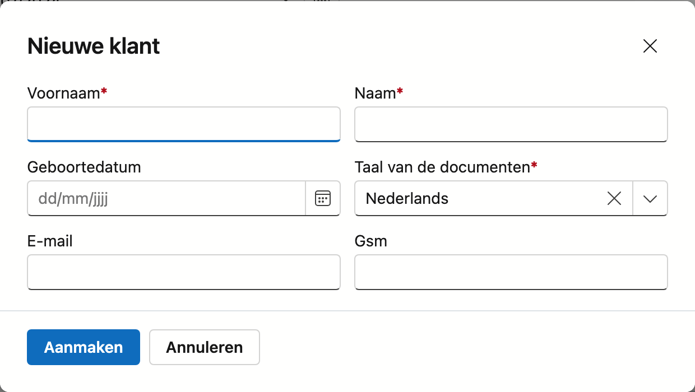
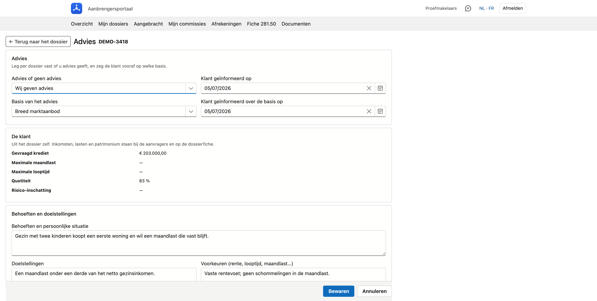

# Mijn dossiers

De dossiers waarin u als aanbrenger staat.

## Het scherm openen

Klik in het portaal bovenaan op **Mijn dossiers**.

## De lijst

Boven de lijst staat hoeveel dossiers er zijn. Per dossier ziet u het **dossiernummer**, de **aanvrager**,
de **status**, de **instelling** en het **kredietbedrag**.

Rechtsboven staat een **zoekveld**. Typ een stuk van een dossiernummer, van de naam van een aanvrager of van een
instelling en de lijst beperkt zich meteen. U kunt ook per kolom sorteren en filteren, en de lijst exporteren.

Mag u van uw kantoor zelf dossiers inleiden, dan staat rechtsboven de knop **Nieuw dossier**, ook zolang u nog
geen enkel dossier hebt: het dossier wordt meteen aangemaakt op uw naam en opent als fiche.

Bent u hoofdaanbrenger en heeft uw kantoor dat zo ingesteld, dan staan hier ook de dossiers van de
kantoren en medewerkers onder u. Anders ziet u enkel uw eigen dossiers.

Klik op een dossiernummer om het dossier te openen. Met **Ctrl-klik** (Cmd op een Mac), het muiswiel of het **pijltje** vooraan de rij opent het in een **nieuw tabblad** van uw browser; de lijst blijft staan.

## Een dossier openen

Het dossier opent op een eigen pagina, met dezelfde inhoud als uw kantoor ziet: kredietgegevens, het pand,
de aanvragers, de contracten, de betrokken partijen en het journaal.

U kunt de dossiers in uw lijst ook **bijwerken**: het scherm werkt zoals in de backoffice, u past aan en klikt op
**Bewaren**. Dat geldt ook voor de dossiers van de kantoren onder u. De interne opmerkingen en de commissie van uw
kantoor ziet u niet.

Het veld **Aanbrenger** toont enkel uw eigen kantoor en de kantoren onder u. Hebt u geen kantoren onder u, dan
staat het vast op uw naam.

## Een klant aan een dossier koppelen

Klik bij **Kredietaanvragers** op **+ Aanvrager koppelen** en kies de klant in de lijst. De lijst toont de klanten
uit de dossiers van uw kantoor en van de kantoren onder u, niet die van andere kantoren.

Staat uw klant er nog niet in, klik dan op **+ Nieuwe klant** onder de lijst.

{ .volle-breedte }

| Veld | Waarvoor |
|---|---|
| **Voornaam**, **Naam** | Verplicht |
| **Geboortedatum** | Helpt uw kantoor om twee klanten met dezelfde naam uit elkaar te houden |
| **Taal van de documenten** | De taal waarin de klant brieven en mails krijgt |
| **E-mail**, **Gsm** | Niet verplicht, maar wel nagekeken: een onvolledig adres of nummer wordt geweigerd |

Klik op **Aanmaken**. De klant staat meteen gekozen; met **Bewaren** hangt u hem aan het dossier.

!!! info "Een klant die al bij uw kantoor bekend is"
    Is uw klant al bekend bij een ander kantoor, dan ziet u hem niet in de lijst, en CreditSoft zegt
    ook niet dat hij bestaat. Maak hem gerust aan: uw kantoor voegt dubbele klanten samen.

## De tabbladen rechts

Rechts op het dossier staan tabbladen. Welke u ziet, hangt af van het dossier en van uw rechten.

**Betrokken partijen** — notaris, schatter, architect en andere derden bij dit dossier.

**Opmerkingen** — de opmerkingen die bij het dossier horen.

**Documenten** — de stand van de documentenchecklist: welk stuk **aanwezig**, **gevalideerd**, **geweigerd**
of **nog te bezorgen** is.

**Documenten opvragen** — hiermee vraagt u ontbrekende stukken rechtstreeks bij uw klant op. Zie
[Documenten opvragen](#documenten-opvragen-bij-uw-klant) hieronder.

**Commissie doorgeven** — alleen wanneer u zelf commissie op dit dossier ontvangt en met eigen makelaars
werkt. Zie [Afrekeningen aan mijn makelaars](afrekeningen.md).

## Het advies

Mag uw kantoor zelf dossiers inleiden, dan legt u op een dossier ook het **advies** vast: of u advies geeft, op welke
basis, wat de klant nodig heeft, welke kredieten u vergeleek en wat u voorstelt. Het werkt zoals voor uw kantoor, zie
[Advies](../credit-management/advice.md). U opent het onderaan het dossier, op het tabblad **Advies**. Een aanbrenger die
enkel klanten aanbrengt, ziet dit tabblad niet.

{ .volle-breedte }

**Het afschrift voor de klant.** Met **+ Afschrift maken** maakt u de kredietvergelijking als pdf. Bovenaan staat het
briefhoofd van uw groep, met daaronder **uw kantoor als contactpersoon**: naam, adres, telefoon, e-mail en uw
FSMA-nummer zoals ze op uw fiche staan. Klopt daar iets niet, vraag uw kantoor dan om uw fiche aan te passen.

**Mailen** verstuurt het afschrift vanaf uw **eigen e-mailadres**, zodat het antwoord van de klant bij u aankomt. Net zoals
bij [documenten opvragen](#documenten-opvragen-bij-uw-klant) kan dat enkel vanaf een adres op een geregistreerd domein van
uw kantoor. Kan het niet, dan staat onder de afschriften waarom, en geeft u het afschrift **op papier** of laat u het uw
kantoor mailen.

## Documenten opvragen bij uw klant

Op het tabblad **Documenten opvragen** kiest u de aanvrager uit de lijst en klikt u op **Aanvraag
versturen**. Uw klant krijgt een link waarmee hij zijn stukken oplaadt.

De link verschijnt ook op uw scherm — wie hem liever telefonisch doorgeeft, heeft hem bij de hand.

!!! info "De aanvraag komt van u, niet van het kantoor"
    Uw klant ziet uw eigen e-mailadres als afzender, en zijn antwoord komt dus bij u terecht.

!!! warning "Waarom u soms geen knop ziet"
    Een e-mail kan alleen vertrekken van een domein dat daarvoor geregistreerd is. Dat is geen instelling
    van CreditSoft maar een beveiliging van het internet zelf: ze verhindert dat iemand post verstuurt in
    andermans naam.

    Staat uw adres op het domein van uw kantoor, dan werkt het meteen. Staat het op een eigen domein of op
    een algemeen adres zoals Gmail, dan leest u in plaats van de knop kort waarom het niet kan. Uw kantoor
    kan dat domein laten registreren.

## Terug naar de lijst

Linksboven staat **Lijst**. Uw zoekopdracht en sortering blijven bewaard, dus u komt terug waar u was.

!!! info "Een dossier dat u niet mag zien"
    Opent u een dossier dat buiten uw bereik valt, dan krijgt u *"Dit dossier is niet beschikbaar."* Dat is
    dezelfde grens als de lijst hanteert: wat er niet in staat, opent ook niet via de adresbalk.

## Zie ook

- [Mijn commissies](commissies.md)
- [Afrekeningen aan mijn makelaars](afrekeningen.md)
