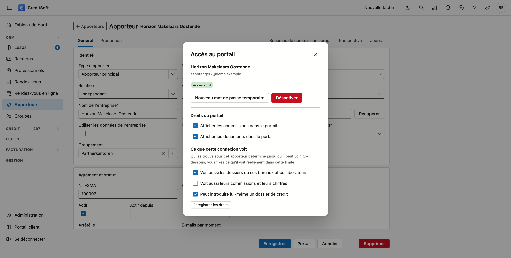

# Le portail apporteurs

Vos apporteurs peuvent se connecter eux-mêmes à CreditSoft et y consulter leurs propres dossiers et
commissions. Ils arrivent dans une partie distincte et cloisonnée de l'application : ils voient uniquement
ce qui les concerne, et rien de votre bureau.

Ces pages décrivent ce qu'un apporteur voit. En tant que courtier, vous les lisez pour savoir ce que vous
distribuez lorsque vous accordez un accès.

## Donner accès

L'accès se règle sur la fiche de l'apporteur.

1. Ouvrez **CRM › Apporteurs** et double-cliquez l'apporteur.
2. Cliquez en haut sur **Portail**.
3. Cliquez sur **Nouveau mot de passe temporaire**.

Le mot de passe s'affiche **une seule fois**. Transmettez-le à l'apporteur ; il devra le modifier lors de
sa première connexion. Si vous l'avez perdu, générez simplement un nouveau mot de passe temporaire —
l'ancien est alors annulé.

**Désactiver** referme l'accès. La fiche et toutes les données restent en place ; seule la connexion ne
fonctionne plus.

## Ce qu'un apporteur peut voir

Les droits se trouvent dans la même fenêtre. Ensemble, ils déterminent ce qui apparaît dans le portail.

| Réglage | Ce qu'il fait |
|---|---|
| **Afficher les commissions dans le portail** | Sans cette case, toute la partie *Mes commissions* disparaît. |
| **Afficher les documents dans le portail** | Détermine si la liste des documents d'un dossier est visible. |
| **Voit aussi les dossiers de ses bureaux et collaborateurs** | Pour un apporteur principal : il voit alors également ce qui dépend de lui. Sans cette case, il ne voit que ses propres dossiers. |
| **Voit aussi leurs commissions et leurs chiffres** | Un droit distinct du précédent. Un responsable de bureau peut voir sur quoi ses collaborateurs travaillent sans savoir ce que cela leur rapporte. |

!!! tip "Les deux droits sur les chiffres sont indépendants, et c'est voulu"
    Quelqu'un peut donc voir les dossiers de ses collaborateurs sans voir leur commission. Chaque écran du
    portail porte une phrase indiquant sur combien de bureaux portent les chiffres affichés — le lecteur sait
    ainsi toujours ce qu'il a sous les yeux.

Avec l'interrupteur **Peut introduire lui-même un dossier de crédit**, l'apporteur obtient dans *Mes dossiers*
le bouton **Nouveau dossier**. Le dossier est créé immédiatement, avec lui comme apporteur et avec le statut de
départ de votre bureau, et s'ouvre comme fiche. Il n'y a pas d'étape où vous l'acceptez d'abord : vous voyez
simplement le dossier apparaître dans votre propre liste.

## Les écrans

- [Aperçu](overzicht.fr.md) — les chiffres de l'année, un graphique par mois et les derniers crédits conclus
- [Mes dossiers](dossiers.fr.md) — la liste, et ce que contient un dossier
- [Apportés](aangebracht.fr.md) — les clients que l'apporteur a transmis, avec leur statut, et la transmission d'un nouveau client
- [Mes commissions](commissies.fr.md) — par année, par mois et par écriture
- [Décomptes à mes courtiers](afrekeningen.fr.md) — pour un bureau avec ses propres courtiers : ce qu'il leur a reversé et décompte
- [Documents](documenten.fr.md) — les documents que votre bureau partage avec les apporteurs

!!! info "Toutes les rubriques ne figurent pas toujours dans la barre de menu"
    Une rubrique sans contenu n'apparaît pas. **Décomptes** apparaît dès que le bureau a reversé une commission à un
    courtier, **Documents** dès que votre bureau partage des documents avec les apporteurs, et **Mes commissions**
    uniquement avec la case *Afficher les commissions dans le portail*. Les images de ce manuel montrent la barre complète.
