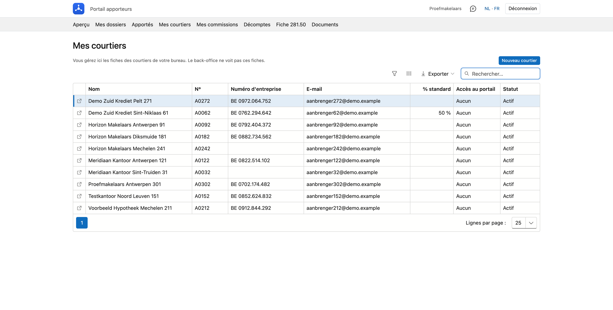

# Mes courtiers

Si votre bureau travaille avec ses propres courtiers et les règle lui-même, vous gérez ici leurs fiches : création, modification et accès au portail.

!!! info "Pour qui ?"
    Uniquement pour un bureau qui règle lui-même ses courtiers. C'est le back-office qui l'active sur la fiche de votre bureau. Si ce n'est pas activé, vous ne voyez pas cette rubrique, et le back-office gère les fiches.

## Ouvrir l'écran

Cliquez en haut du portail sur **Mes courtiers**.

{ .volle-breedte }

## La liste

Par courtier, vous voyez le **nom**, le **numéro**, le **numéro d'entreprise**, l'**adresse e-mail**, le **pourcentage standard**, s'il a un **accès au portail** et son **statut**. Vous pouvez chercher, trier et exporter la liste.

Double-cliquez une ligne pour ouvrir la fiche. Avec **Ctrl-clic** (Cmd sur un Mac), la molette de la souris ou la **flèche** au début de la ligne, elle s'ouvre dans un **nouvel onglet** de votre navigateur.

!!! note "Ce que voit le back-office"
    Le back-office ne peut pas ouvrir ces fiches, et les courtiers ne figurent pas dans sa liste d'apporteurs. Il voit bien leur nom et les montants reversés sur les dossiers et dans les rapports.

## Créer un courtier

Cliquez sur **Nouveau courtier**, complétez la fiche et cliquez sur **Enregistrer**. Le courtier est rattaché à votre bureau et la fiche reste ouverte, pour que vous puissiez lui donner immédiatement un [accès au portail](#acces-au-portail).

{ .volle-breedte }

| Champ | Signification |
|---|---|
| **Forme juridique** | Personne ou entreprise. Pour une personne, vous indiquez le prénom et le nom ; pour une entreprise, le nom et le type d'entreprise. |
| **Relation** | Indépendant, ou collaborateur de votre bureau. |
| **Langue des documents** | La langue de ses documents, comme sa fiche 281.50. |
| **Numéro** | Votre propre numéro pour ce courtier. Il figure dans la liste et sur la fiche 281.50. |
| **Numéro d'entreprise** | Cliquez sur **Récupérer** pour reprendre les données de la Banque-Carrefour des Entreprises : l'adresse et, pour une entreprise, le nom. |
| **N° de registre national** | Pour une personne sans numéro d'entreprise. La fiche 281.50 utilise le numéro d'entreprise s'il y en a un, sinon ce numéro. |
| **N° FSMA** | Son numéro d'inscription auprès de la FSMA. |
| **Adresse et contact** | L'adresse figure sur sa fiche 281.50. L'adresse e-mail est aussi son nom d'utilisateur pour le portail. |

## L'accord

Ce que vous indiquez sur la fiche sous **Accord** est prêt lorsque vous [reversez une commission](afrekeningen.md#reverser-une-commission) à ce courtier. Vous pouvez l'adapter par dossier.

| Champ | Signification |
|---|---|
| **Pourcentage standard de votre commission (%)** | La part de votre propre commission sur un dossier que ce courtier reçoit par défaut. |
| **Payé directement (%)** | La part payée immédiatement. À 100, vous payez la totalité en une fois. Si vous laissez ce champ vide, c'est aussi la valeur par défaut dans la fenêtre. |
| **Étalé sur (mois)** | Sur combien de mois le solde est réparti. Obligatoire dès que vous payez moins de 100 % immédiatement. |
| **IBAN** | Le compte du courtier. |

## Arrêter un courtier

Vous ne supprimez pas un courtier : des commissions et des fiches fiscales peuvent y être liées. S'il arrête, cochez **Arrêté** et indiquez la date dans **Arrêté le**. Si vous voulez aussi l'empêcher de se connecter, désactivez son [accès au portail](#acces-au-portail).

## Accès au portail

Ouvrez la fiche du courtier et cliquez en haut sur **Accès au portail**.

1. Cliquez sur **Donner accès**. La fiche doit pour cela avoir une adresse e-mail et être enregistrée.
2. Le mot de passe temporaire s'affiche **une seule fois** à l'écran. Transmettez-le à votre courtier.
3. À sa première connexion, il choisit lui-même un nouveau mot de passe.

Le mot de passe est perdu ? Cliquez sur **Nouveau mot de passe temporaire**. **Désactiver** ferme l'accès ; la fiche reste en place. **Réactiver** le rouvre.

Dans la même fenêtre, vous déterminez ce qu'il voit dans le portail. Cliquez ensuite sur **Enregistrer les droits**.

| Réglage | Ce qu'il fait |
|---|---|
| **Afficher les commissions dans le portail** | Lui montre la rubrique *Mes commissions*. |
| **Afficher les documents dans le portail** | Lui montre les documents sur un dossier. |
| **Peut introduire et modifier lui-même des dossiers de crédit** | Lui permet de créer et de modifier des dossiers. Vous ne pouvez le donner que si votre bureau en a lui-même le droit. |

## Erreurs fréquentes

!!! warning "Cette adresse e-mail est déjà utilisée"
    Une adresse e-mail appartient à un seul apporteur, car elle sert de nom d'utilisateur pour le portail. Choisissez une autre adresse, enregistrez la fiche et cliquez à nouveau sur **Donner accès**.

!!! warning "Le bouton Donner accès est grisé"
    La fiche n'a pas encore d'adresse e-mail. Indiquez-la, cliquez sur **Enregistrer** et ouvrez à nouveau **Accès au portail**.

## Voir aussi

- [Décomptes à mes courtiers](afrekeningen.md)
- [Fiche 281.50](fiches-281-50.md)
- [Mes dossiers](dossiers.md)
