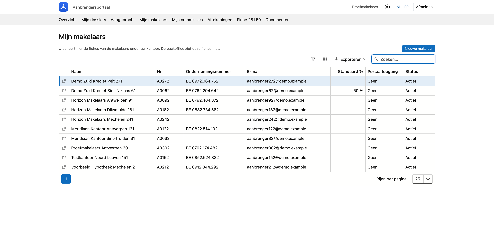

# Mijn makelaars

Werkt uw kantoor met eigen makelaars en rekent het zelf met hen af, dan beheert u hier hun fiches: aanmaken, aanpassen, en hun toegang tot het portaal.

!!! info "Voor wie is dit?"
    Alleen voor een kantoor dat zelf afrekent met zijn makelaars. Dat zet de backoffice aan op de fiche van uw kantoor. Staat het niet aan, dan ziet u dit onderdeel niet, en beheert de backoffice de fiches.

## Het scherm openen

Klik in het portaal bovenaan op **Mijn makelaars**.

{ .volle-breedte }

## De lijst

Per makelaar ziet u de **naam**, het **nummer**, het **ondernemingsnummer**, het **e-mailadres**, het **standaard percentage**, of hij **portaaltoegang** heeft en zijn **status**. U kunt zoeken, sorteren en de lijst exporteren.

Dubbelklik een rij om de fiche te openen. Met **Ctrl-klik** (Cmd op een Mac), het muiswiel of het **pijltje** vooraan de rij opent ze in een **nieuw tabblad** van uw browser.

!!! note "Wat de backoffice ziet"
    De backoffice kan deze fiches niet openen, en de makelaars staan niet in haar lijst van aanbrengers. Hun naam en de doorgegeven bedragen ziet ze wel op de dossiers en in de rapporten.

## Een makelaar aanmaken

Klik op **Nieuwe makelaar**, vul de fiche in en klik op **Bewaren**. De makelaar komt onder uw kantoor te staan en de fiche blijft open, zodat u hem meteen [portaaltoegang](#portaaltoegang) kunt geven.

{ .volle-breedte }

| Veld | Wat het betekent |
|---|---|
| **Rechtsvorm** | Persoon of bedrijf. Bij een persoon vult u voornaam en naam in, bij een bedrijf de bedrijfsnaam en het bedrijfstype. |
| **Relatie** | Zelfstandige, of medewerker van uw kantoor. |
| **Documenttaal** | De taal van zijn documenten, zoals zijn fiche 281.50. |
| **Nummer** | Uw eigen nummer voor deze makelaar. Het staat in de lijst en op de fiche 281.50. |
| **Ondernemingsnummer** | Klik op **Ophalen** om de gegevens uit de Kruispuntbank van Ondernemingen te halen: het adres, en bij een bedrijf ook de naam. |
| **Rijksregisternr.** | Voor wie geen ondernemingsnummer heeft. De fiche 281.50 gebruikt het ondernemingsnummer als er een is, anders dit nummer. |
| **FSMA-nr.** | Zijn inschrijvingsnummer bij de FSMA. |
| **Adres en contact** | Het adres komt op zijn fiche 281.50. Het e-mailadres is ook zijn gebruikersnaam voor het portaal. |

## De afspraak

Wat u op de fiche invult bij **Afspraak**, staat klaar wanneer u [commissie doorgeeft](afrekeningen.md#commissie-doorgeven) aan deze makelaar. U kunt het per dossier aanpassen.

| Veld | Wat het betekent |
|---|---|
| **Standaard percentage van uw commissie (%)** | Welk deel van uw eigen commissie op een dossier deze makelaar standaard krijgt. |
| **Direct uitbetaald (%)** | Welk deel meteen betaald wordt. Op 100 betaalt u alles in één keer. Laat u het leeg, dan is dat ook de standaard in het venster. |
| **Gespreid over (maanden)** | Over hoeveel maanden de rest gespreid wordt. Verplicht zodra u minder dan 100 % direct uitbetaalt. |
| **IBAN** | De rekening van de makelaar. |

## Een makelaar stopzetten

Een makelaar verwijdert u niet: er kunnen commissies en fiscale fiches aan hangen. Stopt hij, vink dan **Gestopt** aan en vul de datum in bij **Gestopt op**. Wil u dat hij ook niet meer kan aanmelden, deactiveer dan zijn [portaaltoegang](#portaaltoegang).

## Portaaltoegang

Open de fiche van de makelaar en klik bovenaan op **Portaaltoegang**.

1. Klik op **Toegang geven**. De fiche moet daarvoor een e-mailadres hebben en bewaard zijn.
2. Het tijdelijke wachtwoord verschijnt **één keer** op het scherm. Geef het door aan uw makelaar.
3. Bij zijn eerste aanmelding kiest hij zelf een nieuw wachtwoord.

Is het wachtwoord kwijt, klik dan op **Nieuw tijdelijk wachtwoord**. Met **Deactiveren** sluit u de toegang af; de fiche blijft staan. Met **Heractiveren** zet u ze weer open.

In hetzelfde venster bepaalt u wat hij in het portaal ziet. Klik daarna op **Rechten bewaren**.

| Instelling | Wat ze doet |
|---|---|
| **Commissies tonen in het portaal** | Toont hem het onderdeel *Mijn commissies*. |
| **Documenten tonen in het portaal** | Toont hem de documenten op een dossier. |
| **Mag zelf kredietdossiers inleiden en wijzigen** | Laat hem dossiers aanmaken en wijzigen. U kunt dit enkel geven als uw kantoor het zelf mag. |

## Veelgemaakte fouten

!!! warning "Dit e-mailadres is al in gebruik"
    Een e-mailadres hoort bij één aanbrenger, want het is de gebruikersnaam voor het portaal. Kies een ander adres, bewaar de fiche en klik opnieuw op **Toegang geven**.

!!! warning "De knop Toegang geven staat uit"
    Op de fiche staat nog geen e-mailadres. Vul het in, klik op **Bewaren** en open **Portaaltoegang** opnieuw.

## Zie ook

- [Afrekeningen aan mijn makelaars](afrekeningen.md)
- [Fiche 281.50](fiches-281-50.md)
- [Mijn dossiers](dossiers.md)
